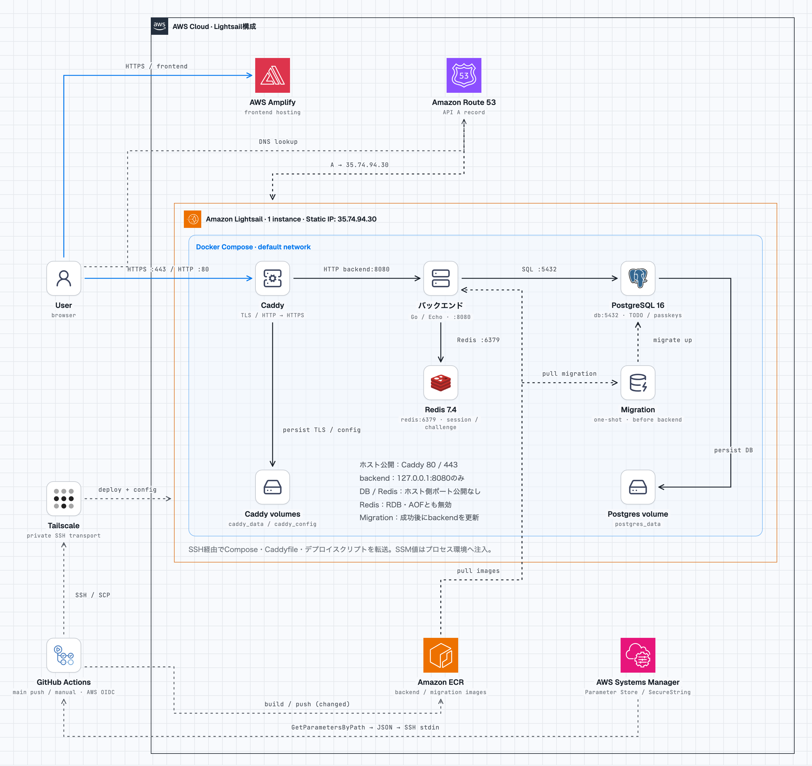
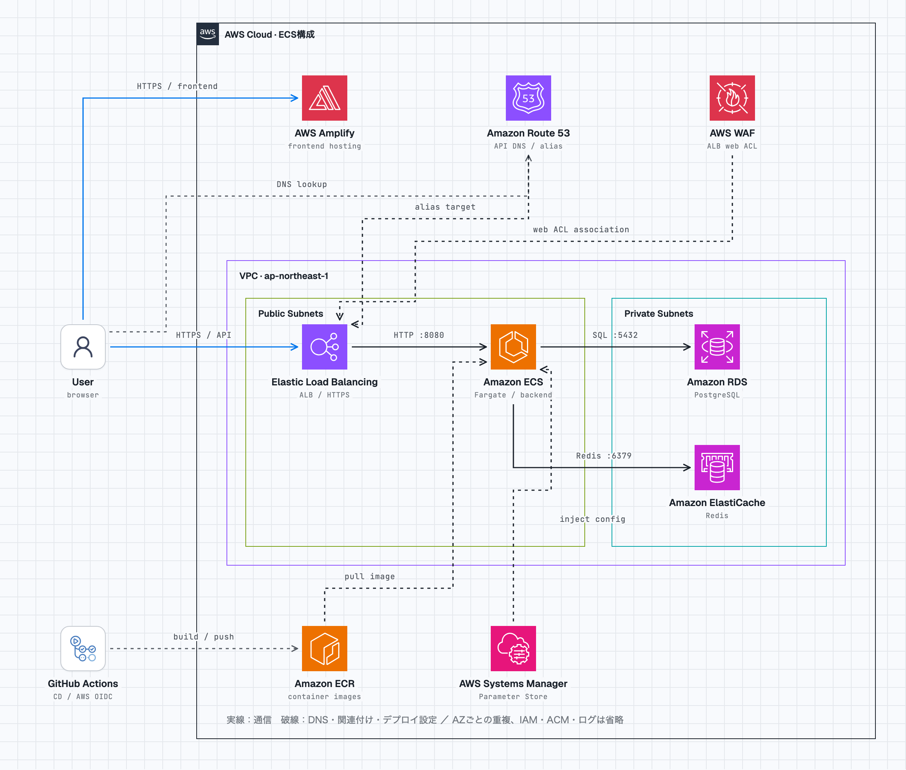

# Design Doc

## 1. 開発方針
    
### 1.1 モノレポ構成

バックエンド、将来追加するフロントエンド、IaCを同一リポジトリで管理するモノレポ構成を採用する。

```text
kyoya67-todo/
├── backend/
├── frontend/
├── api/
├── infra/
├── compose.yaml
├── AGENTS.md
├── DESIGN.md
└── README.md
```

- `backend/`ではGo、Echo、PostgreSQLアクセス、REST APIを管理する。
- `frontend/`は静的フロントエンドを管理し、AWS Amplify Hostingで配信する。
- `api/`ではバックエンドとフロントエンドで共有するAPI仕様をopenapiで管理する。
- `infra/`ではAWS ECS Fargate、ECR、RDS、IAM、Route 53、Amplifyなどのインフラ構成をTerraformで管理する。

### 1.2 環境変数

ローカルの共有設定はプロジェクト直下の`.env`で管理する。Composeは`compose.yaml`と同じディレクトリにある`.env`を、`${VARIABLE}`形式の値を置換するために自動で読み込む。
クラウド環境の設定値はSSM Parameter Storeで管理し、ECSタスク定義から`valueFrom`で注入する。DBユーザー・パスワードはSSMの`SecureString`としても管理する。RDSの作成と既存のLightsail CDがSecrets ManagerのDBシークレットを利用するため、Secrets Managerは残し、ECS向けの設定注入だけをSSMへ統一する。この二重管理は、RDS/Lightsailとの互換性を保つ代わりに、値の同期対象を増やすトレードオフがある。

### 1.3 Docker Composeによるローカル起動

`backend/Dockerfile`はGoのバックエンドコンテナイメージを作成するマルチステージDockerfileとし、ローカル環境とAWS ECS Fargateで共通利用する。
実行環境固有の設定はDockerfileに埋め込まず、ローカルでは`compose.yaml`、AWSではECSタスク定義から環境変数・シークレットを注入する。

---

## 2. AIの活用方針

ChatGPTを要件整理・技術選定・設計相談とIssueの作成に、OpenAI Codexを実装・テスト・調査の支援に利用する。IssueはGitHub Projectsで管理し、変更はPull Requestでレビューする。AIの提案を採用するかは開発者が判断し、変更内容と動作を検証する。

Codexの作業ルールは[AGENTS.md](AGENTS.md)に定める。

## 3. 技術選定とトレードオフ

### 3.1 バックエンド言語

GoはHTTPサーバーをシンプルに構成でき、型とテストを用いてAPIの振る舞いを検証しやすいため採用した。

### 3.2 Webフレームワーク

| 採用 | 技術 | メリット・判断理由 |
|---|---|---|
| ○ | Echo | バインド、エラーハンドリング、ロギングなどの共通処理を利用できる |
| — | Gin | バリデーションとの連携やエコシステムが充実しているが、今回はEchoのエラー処理設計を優先する |
| — | net/http | 外部依存を減らせるが、共通処理の設計・実装が必要になる |

Go標準ライブラリでもREST APIは実装可能である。
しかし、共通エラーハンドリング、リクエストのバインド、ロギング、ミドルウェアなどを自作すると、実装とテストの対象が増加する。
Echoを利用することで独自実装を減らし、業務ロジックとDBアクセスに注力する。
また、Echoのハンドラは`error`を返す構造になっており、エラー処理を共通のハンドラへ委譲できる。
ただし、Echoを採用することでフレームワーク固有の依存が生じる点はトレードオフとなる。

### 3.3 データベース

| 採用 | 技術 | 判断理由 |
|---|---|---|
| ○ | PostgreSQL | 制約、トランザクション、インデックスなどを利用でき、追加機能にも対応しやすい |
| — | MySQL | CRUDには十分だが、今回はPostgreSQLの利用経験と拡張性を優先する |

### 3.4 データアクセス方式

| **採用** | **技術** | **判断理由** |
|---|---|---|
| ○ | sqlc + pgx/v5 | CRUD中心で複雑な動的クエリが少なく、SQLの明示性、生成コードによる型安全性、PostgreSQL向け接続プールを利用できる |
| — | sqlc + database/sql | 型安全なコード生成は利用できるが、今回はPostgreSQL専用の機能とpgxの接続プールを優先する |
| — | GORM | CRUD実装は容易だが、SQLと生成される処理の対応を明示的に管理しにくいため、今回は採用しない |
| — | 生SQL + database/sql | SQLの自由度は高いが、型安全なコード生成や結果のマッピングを個別に実装する必要がある |
| — | 生SQL + pgx | PostgreSQLの機能と接続プールを利用できるが、型安全なコード生成や結果のマッピングを個別に実装する必要がある |

SQLまたはデータベーススキーマを変更した場合は、開発時とCIで`sqlc vet`を実行してSQL・スキーマの整合性を確認し、`sqlc generate`で生成コードを更新する。生成コードは直接編集せず、生成コード自体の単体テストは原則として作成しない。Repositoryについては、sqlc生成コードを介したSQL実行結果、引数、エラー処理をテスト用データベースまたはモックで検証する。

### 3.5 API仕様

| **採用** | **技術** | **判断理由** |
|---|---|---|
| ○ | OpenAPI | REST APIのエンドポイント、パラメータ、リクエスト・レスポンス、HTTPステータスを管理し、仕様と実装の対応を確認しやすくする |
| ○ | oapi-codegen（Echo server） | OpenAPIを正としてGoの型、Echo用Server Interface、ルーティング登録コードを生成し、仕様と実装の不整合をコンパイル時に検出しやすくする |
| △ | Protocol Buffers（`.proto`） | gRPCを追加する場合に、サービス、RPCメソッド、メッセージ型を定義する |
| △ | GraphQL Schema | GraphQLを追加する場合に、Query、Mutation、型、入力値を定義する |
| △ | Protocol Buffers（`.proto`） + Connect | Connectを追加で採用する場合に、RPCメソッドとメッセージ型を定義する |
| — | AsyncAPI | 現時点ではイベント駆動のメッセージングを実装しないため採用しない |

#### OpenAPI・oapi-codegenの採用経緯

APIの具体的なURL、リクエスト・レスポンス形式、入力検証、エラー仕様を仕様書として共有するため、OpenAPIを採用する。OpenAPI定義をAPI仕様の正とするSpec-first方針により、フロントエンド、Swagger UI、バックエンド実装の認識を揃え、実装と仕様のずれを減らす。

仕様書と実装の齟齬をなくすため`oapi-codegen`を利用して、`api/openapi/openapi.yaml`からGoのリクエスト・レスポンスモデル、Echo用のServer Interface、ルーティング登録コード、埋め込み仕様を生成する。生成コードは`backend/internal/openapi/`で管理し、直接編集せず、OpenAPI定義を修正して再生成する。

### 3.6 コンテナ実行環境

| 採用 | 技術 | 判断理由 |
|---|---|---|
| ○ | ECS Fargate | EchoのHTTPサーバーをコンテナとして起動でき、ローカルとAWSで同じイメージを利用できる |
| — | AWS Lambda | 低トラフィック時のコスト面では有利だが、Echoを動かすにはLambda向けの実行方式への対応が必要になる |

ローカルで利用したDockerイメージをECRにプッシュし、ECS Fargateで実行する。
AWS環境は1つのみ構築し、`main`へのマージをデプロイの基準とする。
ECS Serviceは必要時のみタスク数を1に増やし、利用しない場合は0へ減らす。
停止中はAPIへアクセスできないため、READMEに起動・停止手順を記載する。

### 3.7 IaC

| 採用 | 技術 | 判断理由 |
|---|---|---|
| ○ | Terraform | リソースを宣言的に管理し、変更履歴と再現性を確保できる |
| — | CloudFormation | AWSとの統合度は高いが、今回はTerraformの利用を優先する |
| — | 手動構築 | 初期検証は容易だが、構成の再現性や変更管理の面で不利 |

### 3.8 CI/CD

| 採用 | 技術 | 判断理由 |
|---|---|---|
| ○ | GitHub Actions + AWS OIDC | GitHub ActionsからAWSへアクセスする際にOIDCを利用し、長期アクセスキーを保存せずに一時的な認証情報でECR・ECSへのデプロイを行う |
| — | GitHub Actions + AWS長期アクセスキー | セキュリティ上のリスクが高く、長期アクセスキーの管理が必要になるため採用しない |

GitHub Actions用のOIDCプロバイダー、IAMロール、信頼ポリシー、ECR・ECS操作権限はTerraformの`infra/modules/iam/`で管理する。OIDCプロバイダーのAudienceは`sts.amazonaws.com`とし、信頼対象は対象リポジトリの`main`ブランチに限定する。

ECS向けのCDは`.github/workflows/cd-ecs.yml`として残し、手動実行だけに限定する。Lightsail向けのCDは`.github/workflows/cd-lightsail.yml`で管理し、`main`へのマージ後のpushで実行する。Lightsail CDはAWS OIDCでECRへイメージをPushした後、TailscaleのGitHub OIDC接続とSSHを経由してLightsailへECR認証情報を渡し、既存のDocker ComposeサービスをPull・再作成する。Lightsail側にAWS CLIは配置しない。

### 3.9 Go外部パッケージ

| **分類** | **importするパッケージ** | **用途** |
|---|---|---|
| Webフレームワーク | Echo (`github.com/labstack/echo/v4`) | HTTPサーバー、ルーティング、JSONレスポンス、ミドルウェアを提供する |
| PostgreSQLドライバ・接続プール | pgx/v5 (`github.com/jackc/pgx/v5`) | PostgreSQLとの通信、`pgxpool`による接続プール、PostgreSQL固有型を扱う |
| 環境変数ファイル読み込み | godotenv (`github.com/joho/godotenv`) | ローカル開発時にプロジェクトルートの`.env`を読み込む |

### 3.10 認証方式

| 採用 | 方式 | 判断理由・トレードオフ |
|---|---|---|
| ○ | Go APIでWebAuthn（パスキー）を実装 | 初回のユーザー登録からメールアドレス・外部アカウント・OTPを求めず、パスキーだけで始められる。一方、セッション管理や不正利用対策を自分たちで実装・検証する責任が生じる |
| — | Cognito + パスキー | Cognitoはパスキーログインに対応するが、今回検討した自己登録フローでは、パスキーを登録する前にメールの確認コードによる初回確認が必要だった。登録からパスキーだけで完結させる要件に合わない |
| — | Google認証 | 初回から使えるが、レビュアーに既存のGoogleアカウントの利用を求めるため採用しない |

決め手はログイン方法だけでなく、**新規登録の最初の一歩からパスキーだけで完結できるか**だった。レビュアーが所属組織の利用方針によってメールOTPやGoogleアカウントが使えない場合がある。そのためパスキーによる認証基盤を自作した。Cognitoの[パスキー登録手順](https://docs.aws.amazon.com/cognito/latest/developerguide/amazon-cognito-user-pools-authentication-flow-methods.html)でも、ユーザーがパスキーでログインするには先にメール等の認証手段でサインインするフローが示されている。

---

## 4. システム構成とデータモデル

### 4.1 データベース設計

`````mermaid
erDiagram
    users o|--o{ todos : "所有する"
    users ||--o{ passkey_credentials : "登録する"

    users {
        UUID id PK
        TIMESTAMPTZ created_at
    }

    todos {
        BIGSERIAL id PK
        UUID user_id FK "NOT NULL"
        TEXT title
        TEXT status
        TEXT priority_level "高・中・小"
        BIGINT priority "状態・優先度グループ内の表示順"
        TIMESTAMPTZ created_at
        TIMESTAMPTZ updated_at
    }

    passkey_credentials {
        BYTEA credential_id PK
        UUID user_id FK "NOT NULL"
        JSONB credential_data
        TIMESTAMPTZ created_at
        TIMESTAMPTZ last_used_at "NULL可"
    }
`````

`users`はユーザーのIDと作成日時を管理する。`passkey_credentials`はユーザーに紐づくパスキーの公開鍵など、検証に必要な認証情報を保存する。`todos`は所有者ID、タイトル、状態、優先度（高・中・小）、状態・優先度グループ内の順位、作成・更新日時を保存し、ユーザーごとに参照する。

### 4.2 パスキー認証

`````mermaid
sequenceDiagram
    autonumber
    actor User as 利用者
    participant Browser as ブラウザ
    participant Passkey as 端末のパスキー
    participant API as バックエンド
    participant Redis
    participant DB as PostgreSQL

    rect rgb(240, 248, 255)
        Note over User,DB: パスキー登録
        User->>Browser: 登録を選択
        Browser->>API: 登録開始
        API->>Redis: 登録チャレンジと仮のユーザーIDを保存（5分）
        API-->>Browser: 登録オプションとregistrationId
        Browser->>Passkey: navigator.credentials.create（チャレンジ）
        Passkey-->>Browser: 公開鍵を含む登録結果
        Browser->>API: 登録完了（registrationId・登録結果）
        API->>Redis: 登録チャレンジを取得・削除
        API->>API: チャレンジ・Origin・RP IDなどを検証
        API->>DB: usersとpasskey_credentialsを同一トランザクションで保存
        API-->>Browser: 登録完了（204）
    end

    rect rgb(245, 250, 240)
        Note over User,DB: パスキーログインとTODO操作
        User->>Browser: ログインを選択
        Browser->>API: ログイン開始
        API->>Redis: ログインチャレンジを保存（5分）
        API-->>Browser: 認証オプションとloginId
        Browser->>Passkey: navigator.credentials.get（チャレンジ）
        Passkey-->>Browser: 署名付き認証結果
        Browser->>API: ログイン完了（loginId・認証結果）
        API->>Redis: ログインチャレンジを取得・削除
        API->>DB: credential_idから公開鍵とユーザーIDを取得
        API->>API: チャレンジ・Origin・RP ID・署名を検証
        API->>Redis: セッショントークンのハッシュ→ユーザーIDを保存（24時間）
        API-->>Browser: todo_session Cookieを設定（204）
        Browser->>API: TODO操作（Cookieを送信）
        API->>Redis: Cookieのトークンをハッシュ化してユーザーIDを取得
        API->>DB: user_idで絞ってTODOを操作
        API-->>Browser: 操作結果
    end
`````

秘密鍵は端末のパスキー側に残り、バックエンドへ送らない。登録・ログインのチャレンジは一度使うとRedisから削除する。ログイン後はCookieに入れた不透明なトークンからRedis上のセッションを参照し、取得したユーザーIDでTODOへのアクセスを制限する。

### 4.3 AWS構成

AWS環境は1つとし、現在はLightsail版を利用する。Terraformの`deployment_target`で`lightsail`または`ecs`を選択し、APIのDNS参照先とECS版リソースの作成有無を切り替える。フロントエンドは両構成ともAmplifyで配信する。以下の図はリポジトリの実装・設定に基づく構成図で、AWS上のリソースの稼働状況を示すものではない。

#### 4.3.1 Lightsail版（現在の運用構成）

<picture>
  <source media="(prefers-color-scheme: dark)" srcset="docs/architecture/aws-architecture-lightsail-dark.png">
  <source media="(prefers-color-scheme: light)" srcset="docs/architecture/aws-architecture-lightsail.png">
  
</picture>

[ダーク版](docs/architecture/aws-architecture-lightsail-dark.png) · [HTML版](docs/architecture/aws-architecture-lightsail-built.html) · [編集用HTML](docs/architecture/aws-architecture-lightsail.html)

Route 53のAPI用AレコードはLightsailのStatic IPを参照する。ブラウザは名前解決後、Lightsail上のCaddyへ直接接続する。Caddyは80・443番で待ち受け、HTTPをHTTPSへリダイレクトし、TLSを終端してComposeネットワーク内の`backend:8080`へ転送する。DNSは名前解決に使われ、HTTPリクエストを中継するものではない。

1台のLightsail上でCaddy、Go/Echoのバックエンド、PostgreSQL、RedisをDocker Composeで動かす。バックエンドのホスト側ポート公開は`127.0.0.1:8080`に限定し、PostgreSQLとRedisはホスト側へポートを公開しない。TODO・パスキーの公開鍵などを保存するPostgreSQLは`postgres_data`で永続化し、Caddyは`caddy_data`と`caddy_config`を利用する。Redisはチャレンジ・セッションなどの短期データを扱い、RDB・AOFによる永続化を無効にしているため、再作成時にはセッションなどが失われる。

GitHub ActionsはAWS OIDCで認証し、バックエンド・マイグレーション用イメージをECRで管理する。SSM Parameter Storeから取得した設定値をTailscale経由のSSH標準入力でLightsailへ渡し、デプロイスクリプトがComposeのプロセス環境へ注入する。Compose・Caddyfileも必要時に転送する。マイグレーション対象の変更がある場合は専用コンテナを単発実行し、成功した後にバックエンドを更新する。

この構成はALB・RDS・ElastiCacheなどの固定費を抑えられる一方、アプリケーションとDBを同一ホストで運用するため、障害の影響が集中する。ホストの更新・容量管理・バックアップは別途必要であり、Dockerボリュームの永続化だけでは外部バックアップにならない。

#### 4.3.2 ECS版（切り替え用に保持する構成）

<picture>
  <source media="(prefers-color-scheme: dark)" srcset="docs/architecture/aws-architecture-ecs-dark.png">
  <source media="(prefers-color-scheme: light)" srcset="docs/architecture/aws-architecture-ecs.png">
  
</picture>

[ダーク版](docs/architecture/aws-architecture-ecs-dark.png) · [HTML版](docs/architecture/aws-architecture-ecs-built.html) · [編集用HTML](docs/architecture/aws-architecture-ecs.html)

Route 53のAPI用AliasレコードはALBを参照する。ブラウザは名前解決後にALBへHTTPSで接続し、ALBがTLSを終端してECS Fargateのバックエンドへ転送する。WAFはALBに関連付けてリクエストを検査する。TODO・認証情報はプライベートサブネットのRDSへ、チャレンジ・セッションなどの短期データはElastiCache for Redisへ保存する。コンテナイメージはECR、タスクへ注入する設定値はSSM Parameter Storeで管理し、DBマイグレーションは専用のECSタスクで実行する。

ALB、バックエンド用ECSタスク、マイグレーションタスクはパブリックサブネットに配置する。ECSタスクはNAT Gatewayを設けずにECRなどへ接続できるようパブリックIPを使う。これはコストを抑えるための選択であり、プライベート配置と同等の隔離ではない。バックエンドへの着信はセキュリティグループでALBからの8080番に限定し、RDSとRedisへの着信はECSからのみ許可する。図ではAZごとの重複、IAM・ACM・ログなどを省略している。

ECS版への切り替え時は、リソースの作成とDNS変更に加えて、DBデータの移行・マイグレーション・動作確認が必要になる。`deployment_target`の変更だけでLightsail上のデータがRDSへ移るわけではない。

従来の編集用ファイルも履歴・参考資料として保持する：[aws-architecture.drawio](aws-architecture.drawio)。

---

## 5. CI/CD

### 5.1 全体方針

CIはPull Requestの作成・更新時に実行し、フロントエンドのフォーマット・テスト、Goのテスト・静的解析、sqlcのSQL検証と生成コードの差分確認、Terraformのフォーマット・検証、バックエンドコンテナイメージのビルドを行う。CIではAWSへの認証やデプロイを行わず、CDと責務を分離する。
各Issueの作業が完了したら`develop`へPull Requestを作成する。
Phaseに属するすべてのIssueが`develop`へマージされ、統合テストが成功した段階で、`main`へのPull Requestを作成する。
AWS環境は1つのみとし、`main`へのマージをAWSデプロイの基準とする。

### 5.2 CI

CIはPull Requestで実行する。最初に変更パスを判定し、関係する検証ジョブだけを実行する。ワークフロー設定自体を変更した場合は、各検証ジョブを実行する。

- フロントエンド：Node.jsの依存関係をインストールし、Prettierのフォーマットチェックと`npm test`による操作テスト
- バックエンド：`go test ./...`、`go vet ./...`
- sqlc：`sqlc vet`、`sqlc generate`を実行し、生成コードに未コミットの差分がないことを確認
- Terraform：`terraform fmt -check -recursive`、`terraform init -backend=false`、`terraform validate`
- コンテナ：バックエンドのDockerイメージをビルド

CIではAWSへのデプロイは行わず、コードとTerraform構成の静的・ビルド検証に限定する。

### 5.3 CD

`main`へのpush時に変更ファイルを判定し、次のジョブを実行する。AWS認証にはOIDCを使用する。

- `backend/`、`api/`、`infra/`またはCD設定に変更がある場合：バックエンドイメージをコミットハッシュでECRへpushし、ECSタスク定義とServiceを更新する。
- `backend/db/migration/`に変更がある場合：上記のバックエンドジョブ内でマイグレーション用イメージをECRへpushし、ECSワンショットタスクで適用する。成功後にバックエンドをデプロイする。
- Lightsail向けCDでは、`backend/db/migration/`に変更がある場合、マイグレーション用イメージをECRへpushし、バックエンド更新前にLightsailでpull・ワンショット実行する。手動実行時は`run_migration`入力で実行可否を選択する。
- `frontend/`またはCD設定に変更がある場合：独立したフロントエンドジョブで静的ファイルをZIP化し、Amplifyへデプロイして完了を確認する。
