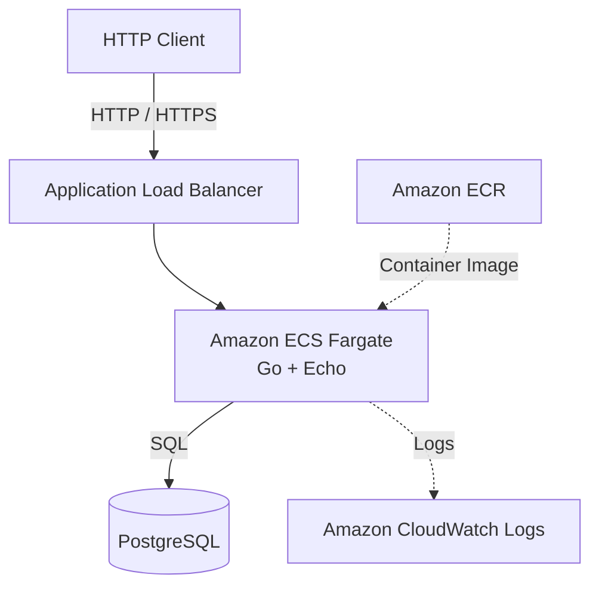

# Design Doc

## 1. 開発方針

本プロジェクトでは、CA Tech Lounge提出型選考の課題として、TODOリストを管理するREST APIを開発する。
まず必須要件の実装とローカル環境でのテストを完了させ、次にTerraformを利用してAWS環境へデプロイする。その後、認証・認可、gRPC、パフォーマンス改善などの追加機能を実装する。
開発工程はGitHub ProjectsのPhaseで管理し、個別の作業はGitHub Issuesで管理する。

選考課題の原文と提出条件はプロジェクト直下の`ASSIGNMENT.md`に記録する。`ASSIGNMENT.md`は外部から与えられた要件の記録、`DESIGN.md`はその要件に対する本プロジェクトの設計判断・開発方針・進捗の記録として扱う。課題文の必須要件と任意の追加要件を混同しない。

### 1.1 用語の定義

- バックエンド：GoとEchoで構成するサーバーアプリケーション全体
- API：バックエンドが提供するHTTPインターフェース
- APIコンテナ：バックエンドを実行するコンテナ
- PostgreSQL：バックエンドから接続するデータベースサービス

以降、アプリケーション全体を指す場合は「バックエンド」、HTTPインターフェースを指す場合は「API」と表記する。課題文の引用・要約では、原文に合わせて「API」と表記する。

### 1.2 PhaseとIssueの構成

#### Phase 1：Local Development

- Issue #1：開発方針の文書化とGo・Echo・PostgreSQLのローカル環境構築
- Issue #2：必須REST API 4本の実装
- Issue #3：OpenAPI仕様の定義
- Issue #4：Docker / Docker Composeによる起動環境構築
- Issue #5：必須機能のテストコード実装
- Issue #6：READMEと動作確認手順の整備

#### Phase 2：AWS Infrastructure

- Issue #7：TerraformによるAWSインフラ構築
- Issue #8：GitHub ActionsとOIDCによるCI/CD構築
- Issue #9：ECS Serviceの起動・停止運用
- Issue #10：AWS上での動作確認と証跡取得

#### Phase 3：Additional Features

- Issue #11：パスキー認証とユーザー別TODO管理
- Issue #12：TODOステータス管理
- Issue #13：TODO優先順位管理
- Issue #14：大量データを想定した負荷試験と性能改善
- Issue #15：追加機能に伴うOpenAPIとテストの更新
- Issue #16：gRPCエンドポイントの追加

### 1.3 ブランチ運用

GitHub ProjectsのPhaseは関連するIssueを開発段階ごとにまとめ、Issueは個別の作業単位として管理する。
開発には`main`、`develop`、Issueごとの作業ブランチを使用する。

1. 各Issueに着手する際、`develop`から作業ブランチ（`feature/issue-1`など）を作成する。
2. 実装・テスト完了後、`develop`に対するPull Requestを作成する。
3. コードレビューとCIの成功を確認したうえで`develop`にマージする。
4. Phase内のすべてのIssueが`develop`にマージされ、統合テストが成功した段階で、`develop`から`main`へのPull Requestを作成する。
5. Phase単位で`main`へマージし、その時点の成果物をリリースする。

`develop`を開発統合用ブランチ、`main`を各Phaseの完了時点における安定版として扱う。
Gitタグは使用せず、Pull Requestとコミット履歴で変更内容を追跡する。

### 1.4 モノレポ構成

バックエンド、将来追加するフロントエンド、IaCを同一リポジトリで管理するモノレポ構成を採用する。

```text
kyoya67-todo/
├── backend/
│   ├── cmd/
│   │   └── api/
│   │       └── main.go
│   ├── internal/
│   │   ├── config/
│   │   ├── database/
│   │   ├── domain/
│   │   ├── handler/
│   │   ├── service/
│   │   └── repository/
│   ├── go.mod
│   ├── go.sum
│   └── Dockerfile
├── frontend/
├── api/
│   └── openapi/
│       └── openapi.yaml
├── infra/
│   └── terraform/
├── ASSIGNMENT.md
├── compose.yaml
├── AGENTS.md
├── DESIGN.md
└── README.md
```

`backend/`ではGo、Echo、PostgreSQLアクセス、REST APIを管理する。`frontend/`はWebアプリケーションを管理し、バックエンドとは独立したアプリケーションとして扱う。ローカルレビュー時の環境依存を減らすため、フロントエンドもコンテナ化し、バックエンド、PostgreSQLとともにComposeから起動できる構成とする。`infra/terraform/`ではAWS ECS Fargate、ECR、RDS、IAMなどのインフラ構成を管理する。

`api/openapi/`では、バックエンドとフロントエンドが共有するREST APIの仕様をOpenAPIで管理する。APIのパス、リクエスト、レスポンス、ステータスコード、入力検証、エラー形式はOpenAPI定義を基準とする。

Goの依存関係は`backend/go.mod`と`backend/go.sum`で管理し、フロントエンドの依存関係とは分離する。`backend/Dockerfile`はバックエンド用コンテナイメージ、`frontend/Dockerfile`はフロントエンド用コンテナイメージの作成方法を定義する。`compose.yaml`はリポジトリのルートへ配置し、ローカル環境でフロントエンド、バックエンド、PostgreSQLをまとめて起動する。

ローカル環境では、原則として`docker compose up --build`でAPI、PostgreSQL、フロントエンドを起動し、レビュー担当者が個別のランタイムや依存パッケージを準備しなくても動作確認できる状態を目指す。クラウド環境では、フロントエンド、API、データベースをそれぞれ適切なサービスへ配置するが、ローカルComposeで利用するコンテナ化の方針と矛盾しない構成にする。

---

## 2. AIの活用方針

本プロジェクトでは、ChatGPTとOpenAI Codexを開発プロセスに取り入れる。
ChatGPTを技術選定・設計相談・タスク管理に利用し、Codexを実装支援に利用する。

### 2.1 使用するツール

- ChatGPT：技術調査、設計相談、タスク分解、GitHub Issuesの作成
- OpenAI Codex：コード実装、テスト作成、エラー原因の調査、コード修正
- GitHub Projects：開発工程とIssueの進捗管理
- GitHub Pull Requests：変更差分の確認とレビュー

### 2.2 ChatGPTを利用した技術選定

開発開始前にChatGPTとの対話を通じて、バックエンドの技術選定とAWSへのデプロイ方式を検討した。

主な検討内容は以下のとおり。

- Go標準ライブラリとGin・Echoの比較
- EchoとGinのルーティング・エラーハンドリングの違い
- HTTP QUERYメソッドとGET・POSTの使い分け
- AWS LambdaとECS Fargateの比較
- ローカルとAWS環境におけるDockerイメージの再利用
- ECS Serviceを必要時のみ起動するコスト管理方式
- Terraformによるインフラ構築
- GitHub ActionsとOIDCによるAWSへのデプロイ

技術選定では、特定のフレームワークの性能だけでなく、実装の複雑さ、テストの負担、保守性、学習目的などを比較した。
ChatGPTの提案をそのまま採用するのではなく、課題の要件に適しているかを判断基準とした。

### 2.3 ChatGPTによるタスク管理

技術選定後、ChatGPTとGitHubリポジトリを連携し、開発計画をGitHub Issuesに落とし込んだ。

実施した作業は以下のとおり。

1. 課題の必須要件と追加要件を整理する。
2. 開発工程を3つのPhaseに分割する。
3. 各Phaseに必要な作業をIssue単位に分解する。
4. ChatGPTのGitHub連携を利用して16件のIssueを作成する。
5. GitHub ProjectsでPhaseごとにタスクを管理する方針を定める。

### 2.4 Codexによる実装支援

実装工程では、CodexにGitHub Issueを参照させ、Issueに記載した要件と完了条件に従って作業を進めてもらう方針とする。

想定する開発フローは以下のとおり。

1. GitHub Issueで実装範囲と完了条件を定義する。
2. `develop`からIssue用の作業ブランチを作成する。
3. Codexに対象Issueの実装を依頼する。
4. Codexがコードとテストを作成する。
5. 開発者が変更差分と生成コードをレビューする。
6. テスト・動作確認を実施し、必要に応じて修正する。
7. Pull Requestを`develop`へマージする。
8. 対象Issueを完了として更新する。

### 2.5 開発者自身が判断・検証すること

以下の項目については開発者自身が最終的な責任を持つ。

- 課題の要件解釈
- 技術選定とアーキテクチャの決定
- APIとデータモデルの設計
- AI生成コードの理解とレビュー
- テストの妥当性の確認
- 実際の動作確認
- セキュリティ・保守性・パフォーマンスの検証
- AIの提案を採用・修正・却下する判断
- Design Docの内容

AIが生成したコードや文章については、使用箇所、採用理由、検証方法を記録する。また、選考課題の注意事項に従い、AIの利用目的や主なプロンプトも記録する。実施済みの作業と今後の予定は明確に区別し、実際に行っていない検証を実施済みとして記載しない。

---

## 3. 要件の整理

### 3.1 必須機能要件

本課題では、TODOリストを管理する4つのREST APIを実装する。

#### TODO作成

タイトルを指定してTODOを新規作成する。

データベースに最低限保存する項目は以下のとおり。

- TODOを一意に識別するID
- タイトル
- 登録日時
- 更新日時

正常に作成された場合はHTTP 204を返す。

#### TODO一覧取得

データベースに保存されたTODOの一覧を取得する。
特定のクエリパラメータが指定された場合、タイトルが指定された文字列に部分一致するTODOのみ取得する。
正常に取得できた場合はHTTP 200を返し、TODOの配列をJSON形式で返す。

#### TODO更新

指定されたTODOのタイトルと更新日時を変更する。

- 正常時：204
- 指定したTODOが存在しない場合：404

#### TODO削除

指定されたTODOをデータベースから削除する。

- 正常時：204
- 指定したTODOが存在しない場合：404

APIの具体的なURL、リクエスト・レスポンス形式、入力検証、エラー仕様はOpenAPIで定義する。

### 3.2 追加機能要件

- パスキー認証によるログイン
- ユーザーごとのTODO管理
- 未着手・進行中・完了のステータス管理
- TODOの優先順位設定
- 大量データ登録時の負荷対策
- gRPCによるAPIの提供

### 3.3 非機能要件・開発上の方針

- Dockerでアプリケーションを起動できる
- PostgreSQLにTODOを永続化する
- 必須機能を検査するテストを用意する
- AWS上にアプリケーションをデプロイできる
- Terraformでインフラ構成を再現できる
- GitHub ActionsでCI/CDを実行する
- AWSへの認証にはOIDCを使用する
- アプリケーションログを記録する
- 必要な時間のみECSタスクを起動してコストを抑える

---

## 4. 技術選定とトレードオフ

### 4.1 バックエンド言語

| 採用 | 技術 | 判断理由 |
|---|---|---|
| ○ | Go | HTTPサーバーやDBアクセスを実装しやすく、既存の学習経験を活用できる |
| — | TypeScript / Node.js | 実装経験はあるが、今回はGoでのバックエンド実装を重視する |

### 4.2 Webフレームワーク

| 採用 | 技術 | メリット・判断理由 |
|---|---|---|
| ○ | Echo | バインド、エラーハンドリング、ロギングなどの共通処理を利用できる |
| — | Gin | バリデーションとの連携やエコシステムが充実しているが、今回はEchoのエラー処理設計を優先する |
| — | net/http | 外部依存を減らせるが、共通処理の設計・実装が必要になる |

Go標準ライブラリでもREST APIは実装可能である。
しかし、共通エラーハンドリング、リクエストのバインド、ロギング、ミドルウェアなどを自作すると、実装とテストの対象が増加する。
Echoを利用することで独自実装を減らし、業務ロジックとDBアクセスに注力する。
また、Echoのハンドラは`error`を返す構造になっており、エラー処理を共通のハンドラへ委譲できる。
ただし、Echoを採用することでフレームワーク固有の依存が生じる点はトレードオフとなる。

### 4.3 データベース

| 採用 | 技術 | 判断理由 |
|---|---|---|
| ○ | PostgreSQL | 制約、トランザクション、インデックスなどを利用でき、追加機能にも対応しやすい |
| — | MySQL | CRUDには十分だが、今回はPostgreSQLの利用経験と拡張性を優先する |

### 4.4 API仕様

**採用：OpenAPI**

APIのエンドポイント、パラメータ、リクエスト・レスポンス、HTTPステータスを定義する。
実装とOpenAPI仕様の乖離を防ぐため、API変更時には仕様とテストも更新する。
HTTP QUERYメソッドについても検討したが、今回必要なタイトル部分一致検索やステータスによる絞り込みはGETのクエリパラメータで十分表現できる。
そのため、初期実装ではQUERYメソッドを採用しない。

### 4.5 コンテナ実行環境

| 採用 | 技術 | 判断理由 |
|---|---|---|
| ○ | ECS Fargate | EchoのHTTPサーバーをコンテナとして起動でき、ローカルとAWSで同じイメージを利用できる |
| — | AWS Lambda | 低トラフィック時のコスト面では有利だが、Echoを動かすにはLambda向けの実行方式への対応が必要になる |

ローカルで利用したDockerイメージをECRにプッシュし、ECS Fargateで実行する。
AWS環境は1つのみ構築し、`main`へのマージをデプロイの基準とする。
ECS Serviceは必要時のみタスク数を1に増やし、利用しない場合は0へ減らす。
停止中はAPIへアクセスできないため、READMEに起動・停止手順を記載する。

### 4.6 IaC

| 採用 | 技術 | 判断理由 |
|---|---|---|
| ○ | Terraform | リソースを宣言的に管理し、変更履歴と再現性を確保できる |
| — | CloudFormation | AWSとの統合度は高いが、今回はTerraformの利用を優先する |
| — | 手動構築 | 初期検証は容易だが、構成の再現性や変更管理の面で不利 |

### 4.7 CI/CD

**採用：GitHub Actions + AWS OIDC**

GitHub ActionsからAWSへアクセスする際はOIDCを利用する。
長期アクセスキーをGitHub Secretsに保存せず、一時的な認証情報を利用してECR・ECSへのデプロイを行う。

---

## 5. システム構成とデータモデル

### 5.1 バックエンドの構成

### 5.2 データベース設計

### 5.3 AWS構成

AWS環境は1つのみ構築する。



この図は現時点で決定している技術を中心に表した概念図であり、VPC・サブネット・DBの配置・セキュリティグループなどの詳細構成は今後決定する。

---

## 6. CI/CD

### 6.1 全体方針

CIはPull Requestの作成・更新時に実行し、フォーマットチェック、静的解析、テストなどを実行する。
各Issueの作業が完了したら`develop`へPull Requestを作成する。
Phaseに属するすべてのIssueが`develop`へマージされ、統合テストが成功した段階で、`main`へのPull Requestを作成する。
AWS環境は1つのみとし、`main`へのマージをAWSデプロイの基準とする。

### 6.2 CI

### 6.3 CD
