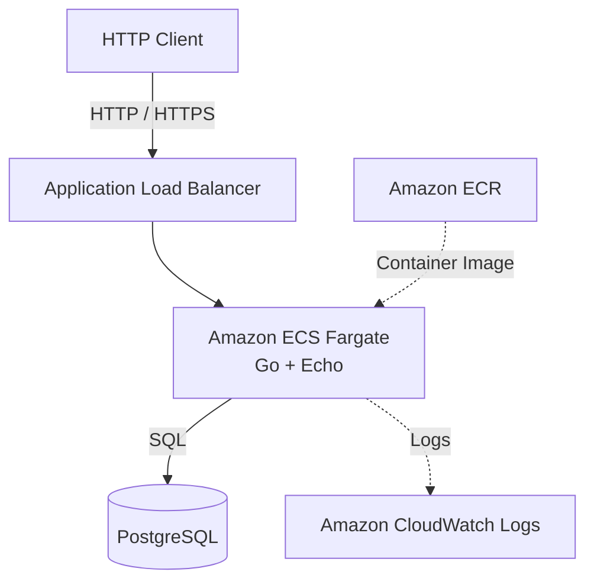

# Design Doc

## 1. 開発方針

### 1.1 PhaseとIssueの構成
phase1ではローカル環境での開発、phase2ではAWS環境へのデプロイ、phase3では追加機能の実装を行う。それぞれのphaseに対応するIssueを順次消化していく。

#### Phase 1：Local Development

- Issue #1：開発方針の文書化とGo・Echo・PostgreSQLのローカル環境構築
- Issue #2：必須REST API 4本の実装
- Issue #3：OpenAPI仕様の定義
- Issue #4：Docker / Docker Composeによる起動環境構築
- Issue #5：必須機能のテストコード実装
- Issue #6：READMEと動作確認手順の整備

#### Phase 2：AWS Infrastructure

- Issue #7：TerraformによるAWSインフラ構築
- Issue #8：GitHub ActionsとOIDCによるCI/CD構築
- Issue #9：ECS Serviceの起動・停止運用
- Issue #10：AWS上での動作確認と証跡取得

#### Phase 3：Additional Features

- Issue #11：パスキー認証とユーザー別TODO管理
- Issue #12：TODOステータス管理
- Issue #13：TODO優先順位管理
- Issue #14：大量データを想定した負荷試験と性能改善
- Issue #15：追加機能に伴うOpenAPIとテストの更新
- Issue #16：gRPCエンドポイントの追加

### 1.2 ブランチ運用

GitHub ProjectsのPhaseは関連するIssueを開発段階ごとにまとめ、Issueは個別の作業単位として管理する。
開発には`main`、`develop`、Issueごとの作業ブランチを使用する。

1. 各Issueに着手する際、`develop`から作業ブランチ（`feature/issue-1`など）を作成する。
2. 実装・テスト完了後、`develop`に対するPull Requestを作成する。
3. コードレビューとCIの成功を確認したうえで`develop`にマージする。
4. Phase内のすべてのIssueが`develop`にマージされ、統合テストが成功した段階で、`develop`から`main`へのPull Requestを作成する。
5. Phase単位で`main`へマージし、その時点の成果物をリリースする。

### 1.3 モノレポ構成

バックエンド、将来追加するフロントエンド、IaCを同一リポジトリで管理するモノレポ構成を採用する。

```text
kyoya67-todo/
├── backend/
├── frontend/
├── api/
├── infra/
├── ai-usage/
├── compose.yaml
├── ASSIGNMENT.md
├── AGENTS.md
├── DESIGN.md
└── README.md
```

- `backend/`ではGo、Echo、PostgreSQLアクセス、REST APIを管理する。
- `frontend/`は静的フロントエンドを管理し、AWS Amplify Hostingで配信する。
- `api/`ではバックエンドとフロントエンドで共有するAPI仕様をopenapiで管理する。
- `infra/`ではAWS ECS Fargate、ECR、RDS、IAM、Route 53、Amplifyなどのインフラ構成をTerraformで管理する。
- `ai-usage/`ではPull RequestごとのAI利用記録を管理する。

### 1.3 環境変数

ローカルの共有設定はプロジェクト直下の`.env`で管理する。Composeは`compose.yaml`と同じディレクトリにある`.env`を、`${VARIABLE}`形式の値を置換するために自動で読み込む。
クラウド環境の秘密情報は、Composeの`.env`ではなくSecrets Managerで管理する。

### 1.4 Docker Composeによるローカル起動

`backend/Dockerfile`はGoのバックエンドコンテナイメージを作成するマルチステージDockerfileとし、ローカル環境とAWS ECS Fargateで共通利用する。
実行環境固有の設定はDockerfileに埋め込まず、ローカルでは`compose.yaml`、AWSではECSタスク定義から環境変数・シークレットを注入する。

---

## 2. AIの活用方針

本プロジェクトでは、ChatGPTとOpenAI Codexを開発プロセスに取り入れる。
ChatGPTを技術選定・設計相談・タスク管理に利用し、Codexを実装支援に利用する。

### 2.1 使用するツール

- ChatGPT：技術調査、設計相談、タスク分解、GitHub Issuesの作成
- OpenAI Codex：コード実装、テスト作成、エラー原因の調査、コード修正
- GitHub Projects：開発工程とIssueの進捗管理
- GitHub Pull Requests：変更差分の確認とレビュー

### 2.2 ChatGPTを利用した技術選定

開発開始前にChatGPTとの対話を通じて、バックエンドの技術選定とAWSへのデプロイ方式を検討した。

- Go標準ライブラリとGin・Echoの比較
- EchoとGinのルーティング・エラーハンドリングの違い
- HTTP QUERYメソッドとGET・POSTの使い分け
- AWS LambdaとECS Fargateの比較
- ローカルとAWS環境におけるDockerイメージの再利用
- ECS Serviceを必要時のみ起動するコスト管理方式
- Terraformによるインフラ構築
- GitHub ActionsとOIDCによるAWSへのデプロイ

### 2.3 ChatGPTによるタスク管理

技術選定後、ChatGPTとGitHubリポジトリを連携し、開発計画をGitHub Issuesに落とし込んだ。

1. 課題の必須要件と追加要件を整理する。
2. 開発工程を3つのPhaseに分割する。
3. 各Phaseに必要な作業をIssue単位に分解する。
5. ChatGPTのGitHub連携を利用して16件のIssueを作成する。
5. GitHub ProjectsでPhaseごとにタスクを管理する方針を定める。

### 2.4 Codexによる実装支援

実装工程では、CodexにGitHub Issueを参照させ、Issueに記載した要件と完了条件に従って作業を進めてもらう方針とする。

1. GitHub Issueで実装範囲と完了条件を定義する。
2. `develop`からIssue用の作業ブランチを作成する。
3. Codexに対象Issueの実装を依頼する。
5. Codexがコードとテストを作成する。
5. 開発者が変更差分と生成コードをレビューする。
6. テスト・動作確認を実施し、必要に応じて修正する。
7. Pull Requestを`develop`へマージする。
8. 対象Issueを完了として更新する。

### 2.5 開発者自身が判断・検証すること

- 課題の要件解釈
- 技術選定とアーキテクチャの決定
- APIとデータモデルの設計
- AI生成コードの理解とレビュー
- テストの妥当性の確認
- 実際の動作確認
- セキュリティ・保守性・パフォーマンスの検証
- AIの提案を採用・修正・却下する判断
- Design Docの内容

AIの具体的な利用履歴、代表的なプロンプト、採用・修正・不採用の判断、検証結果は、プロジェクト直下の`ai-usage/`でPRごとにファイルを分けて管理する。

## 3. 技術選定とトレードオフ

### 3.1 バックエンド言語

課題文にGoでの実装を推奨する旨が記載されているため、本プロジェクトではGoを採用する。

### 3.2 Webフレームワーク

| 採用 | 技術 | メリット・判断理由 |
|---|---|---|
| ○ | Echo | バインド、エラーハンドリング、ロギングなどの共通処理を利用できる |
| — | Gin | バリデーションとの連携やエコシステムが充実しているが、今回はEchoのエラー処理設計を優先する |
| — | net/http | 外部依存を減らせるが、共通処理の設計・実装が必要になる |

Go標準ライブラリでもREST APIは実装可能である。
しかし、共通エラーハンドリング、リクエストのバインド、ロギング、ミドルウェアなどを自作すると、実装とテストの対象が増加する。
Echoを利用することで独自実装を減らし、業務ロジックとDBアクセスに注力する。
また、Echoのハンドラは`error`を返す構造になっており、エラー処理を共通のハンドラへ委譲できる。
ただし、Echoを採用することでフレームワーク固有の依存が生じる点はトレードオフとなる。

### 3.3 データベース

| 採用 | 技術 | 判断理由 |
|---|---|---|
| ○ | PostgreSQL | 制約、トランザクション、インデックスなどを利用でき、追加機能にも対応しやすい |
| — | MySQL | CRUDには十分だが、今回はPostgreSQLの利用経験と拡張性を優先する |

### 3.4 データアクセス方式

| **採用** | **技術** | **判断理由** |
|---|---|---|
| ○ | sqlc + pgx/v5 | CRUD中心で複雑な動的クエリが少なく、SQLの明示性、生成コードによる型安全性、PostgreSQL向け接続プールを利用できる |
| — | sqlc + database/sql | 型安全なコード生成は利用できるが、今回はPostgreSQL専用の機能とpgxの接続プールを優先する |
| — | GORM | CRUD実装は容易だが、SQLと生成される処理の対応を明示的に管理しにくいため、今回は採用しない |
| — | 生SQL + database/sql | SQLの自由度は高いが、型安全なコード生成や結果のマッピングを個別に実装する必要がある |
| — | 生SQL + pgx | PostgreSQLの機能と接続プールを利用できるが、型安全なコード生成や結果のマッピングを個別に実装する必要がある |

SQLまたはデータベーススキーマを変更した場合は、開発時とCIで`sqlc vet`を実行してSQL・スキーマの整合性を確認し、`sqlc generate`で生成コードを更新する。生成コードは直接編集せず、生成コード自体の単体テストは原則として作成しない。Repositoryについては、sqlc生成コードを介したSQL実行結果、引数、エラー処理をテスト用データベースまたはモックで検証する。

### 3.5 API仕様

| **採用** | **技術** | **判断理由** |
|---|---|---|
| ○ | OpenAPI | 必須要件であるREST APIのエンドポイント、パラメータ、リクエスト・レスポンス、HTTPステータスを管理する。課題文で明示された必須要件ではないが、仕様と実装の対応を確認しやすくするため採用する |
| ○ | oapi-codegen（Echo server） | OpenAPIを正としてGoの型、Echo用Server Interface、ルーティング登録コードを生成し、仕様と実装の不整合をコンパイル時に検出しやすくする |
| △ | Protocol Buffers（`.proto`） | 課題文の追加要件であるgRPCを実装する場合に、サービス、RPCメソッド、メッセージ型を定義する。gRPCを実装する余裕がある場合に採用する |
| △ | GraphQL Schema | 課題文の追加要件であるGraphQLを実装する場合に、Query、Mutation、型、入力値を定義する。GraphQLを実装する余裕がある場合に採用する |
| △ | Protocol Buffers（`.proto`） + Connect | Connectを追加で採用する場合に、RPCメソッドとメッセージ型を定義する。課題文にConnectの指定はないため、gRPCやGraphQLより優先しない |
| — | AsyncAPI | 現時点ではイベント駆動のメッセージングを実装しないため採用しない |

#### OpenAPI・oapi-codegenの採用経緯

APIの具体的なURL、リクエスト・レスポンス形式、入力検証、エラー仕様を仕様書として共有するため、OpenAPIを採用する。OpenAPI定義をAPI仕様の正とするSpec-first方針により、フロントエンド、Swagger UI、バックエンド実装の認識を揃え、実装と仕様のずれを減らす。

仕様書と実装の齟齬をなくすため`oapi-codegen`を利用して、`api/openapi/openapi.yaml`からGoのリクエスト・レスポンスモデル、Echo用のServer Interface、ルーティング登録コード、埋め込み仕様を生成する。生成コードは`backend/internal/openapi/`で管理し、直接編集せず、OpenAPI定義を修正して再生成する。

TODOステータスはフロントエンドで未着手・進行中・完了の3列に表示する。作成時は状態を指定せず、API側で未着手を初期値にする。既存の静的HTML・CSS・JavaScriptとブラウザ標準のドラッグ＆ドロップAPIを使い、列間の移動をAPIの状態更新につなぐ。3列の移動だけであればReactを導入するほど画面状態は複雑ではない。状態メニューを置かずドラッグ操作に統一し、タッチ操作は長押し後にドラッグできるようにする。更新が失敗した場合は最後に取得したデータに表示を戻す。

優先順位はステータス列内の上下順として扱い、小さい`priority`ほど上に表示する。作成時は列末尾の値を自動設定し、既存TODOには更新日時順の値を移行時に割り当てる。同じ列内でカードをドラッグすると`PUT /todos/{id}/position`へ移動先の直後にあるTODOのIDを送り、DBトランザクション内でそのユーザーの列全体を連番に振り直す。別の列へ移した場合はその列の末尾へ追加する。並べ替えAPIは列全体のIDを受け取らないため、画面で表示していないTODOがあっても指定したカードの直前へ移動できる。ただし一覧の既定取得上限は100件であり、表示外のカードを直接ドラッグすることはできない。作成・更新APIは必須仕様を優先して204・本文なしとし、画面は成功後に一覧を再取得する。

### 3.6 コンテナ実行環境

| 採用 | 技術 | 判断理由 |
|---|---|---|
| ○ | ECS Fargate | EchoのHTTPサーバーをコンテナとして起動でき、ローカルとAWSで同じイメージを利用できる |
| — | AWS Lambda | 低トラフィック時のコスト面では有利だが、Echoを動かすにはLambda向けの実行方式への対応が必要になる |

ローカルで利用したDockerイメージをECRにプッシュし、ECS Fargateで実行する。
AWS環境は1つのみ構築し、`main`へのマージをデプロイの基準とする。
ECS Serviceは必要時のみタスク数を1に増やし、利用しない場合は0へ減らす。
停止中はAPIへアクセスできないため、READMEに起動・停止手順を記載する。

### 3.7 IaC

| 採用 | 技術 | 判断理由 |
|---|---|---|
| ○ | Terraform | リソースを宣言的に管理し、変更履歴と再現性を確保できる |
| — | CloudFormation | AWSとの統合度は高いが、今回はTerraformの利用を優先する |
| — | 手動構築 | 初期検証は容易だが、構成の再現性や変更管理の面で不利 |

### 3.8 CI/CD

| 採用 | 技術 | 判断理由 |
|---|---|---|
| ○ | GitHub Actions + AWS OIDC | GitHub ActionsからAWSへアクセスする際にOIDCを利用し、長期アクセスキーを保存せずに一時的な認証情報でECR・ECSへのデプロイを行う |
| — | GitHub Actions + AWS長期アクセスキー | セキュリティ上のリスクが高く、長期アクセスキーの管理が必要になるため採用しない |

GitHub Actions用のOIDCプロバイダー、IAMロール、信頼ポリシー、ECR・ECS操作権限はTerraformの`infra/modules/iam/`で管理する。OIDCプロバイダーのAudienceは`sts.amazonaws.com`とし、信頼対象は対象リポジトリの`main`ブランチに限定する。

### 3.9 Go外部パッケージ

| **分類** | **importするパッケージ** | **用途** |
|---|---|---|
| Webフレームワーク | Echo (`github.com/labstack/echo/v4`) | HTTPサーバー、ルーティング、JSONレスポンス、ミドルウェアを提供する |
| PostgreSQLドライバ・接続プール | pgx/v5 (`github.com/jackc/pgx/v5`) | PostgreSQLとの通信、`pgxpool`による接続プール、PostgreSQL固有型を扱う |
| 環境変数ファイル読み込み | godotenv (`github.com/joho/godotenv`) | ローカル開発時にプロジェクトルートの`.env`を読み込む |

### 3.10 認証方式

| 採用 | 方式 | 判断理由・トレードオフ |
|---|---|---|
| ○ | Go APIでWebAuthn（パスキー）を実装 | 初回のユーザー登録からメールアドレス・外部アカウント・OTPを求めず、パスキーだけで始められる。一方、セッション管理や不正利用対策を自分たちで実装・検証する責任が生じる |
| — | Cognito + パスキー | Cognitoはパスキーログインに対応するが、今回検討した自己登録フローでは、パスキーを登録する前にメールの確認コードによる初回確認が必要だった。登録からパスキーだけで完結させる要件に合わない |
| — | Google認証 | 初回から使えるが、レビュアーに既存のGoogleアカウントの利用を求めるため採用しない |

決め手はログイン方法だけでなく、**新規登録の最初の一歩からパスキーだけで完結できるか**だった。メールOTPやGoogleアカウントを求めると、レビュアーが所属組織の利用方針によって使いづらい場合がある。Cognitoの[パスキー登録手順](https://docs.aws.amazon.com/cognito/latest/developerguide/amazon-cognito-user-pools-authentication-flow-methods.html)でも、既存ユーザーがパスキーを追加するには先に別の認証手段でサインインするフローが示されている。AWSを使わず各開発者がローカルで同じ認証フローを試せる点は副次的な利点である。

---

## 4. システム構成とデータモデル

### 4.1 データベース設計

`````mermaid
erDiagram
    users o|--o{ todos : "所有する"
    users ||--o{ passkey_credentials : "登録する"

    users {
        UUID id PK
        TIMESTAMPTZ created_at
    }

    todos {
        BIGSERIAL id PK
        UUID user_id FK "NOT NULL"
        TEXT title
        TEXT status
        BIGINT priority "列内の表示順"
        TIMESTAMPTZ created_at
        TIMESTAMPTZ updated_at
    }

    passkey_credentials {
        BYTEA credential_id PK
        UUID user_id FK "NOT NULL"
        JSONB credential_data
        TIMESTAMPTZ created_at
        TIMESTAMPTZ last_used_at "NULL可"
    }
`````

`users`はユーザーのIDと作成日時を管理する。`passkey_credentials`はユーザーに紐づくパスキーの公開鍵など、検証に必要な認証情報を保存する。`todos`は所有者ID、タイトル、状態、列内の優先順位、作成・更新日時を保存し、ユーザーごとに参照する。

### 4.2 パスキー認証

`````mermaid
sequenceDiagram
    autonumber
    actor User as 利用者
    participant Browser as ブラウザ
    participant Passkey as 端末のパスキー
    participant API as バックエンド
    participant Redis
    participant DB as PostgreSQL

    rect rgb(240, 248, 255)
        Note over User,DB: パスキー登録
        User->>Browser: 登録を選択
        Browser->>API: 登録開始
        API->>Redis: 登録チャレンジと仮のユーザーIDを保存（5分）
        API-->>Browser: 登録オプションとregistrationId
        Browser->>Passkey: navigator.credentials.create（チャレンジ）
        Passkey-->>Browser: 公開鍵を含む登録結果
        Browser->>API: 登録完了（registrationId・登録結果）
        API->>Redis: 登録チャレンジを取得・削除
        API->>API: チャレンジ・Origin・RP IDなどを検証
        API->>DB: usersとpasskey_credentialsを同一トランザクションで保存
        API-->>Browser: 登録完了（204）
    end

    rect rgb(245, 250, 240)
        Note over User,DB: パスキーログインとTODO操作
        User->>Browser: ログインを選択
        Browser->>API: ログイン開始
        API->>Redis: ログインチャレンジを保存（5分）
        API-->>Browser: 認証オプションとloginId
        Browser->>Passkey: navigator.credentials.get（チャレンジ）
        Passkey-->>Browser: 署名付き認証結果
        Browser->>API: ログイン完了（loginId・認証結果）
        API->>Redis: ログインチャレンジを取得・削除
        API->>DB: credential_idから公開鍵とユーザーIDを取得
        API->>API: チャレンジ・Origin・RP ID・署名を検証
        API->>Redis: セッショントークンのハッシュ→ユーザーIDを保存（24時間）
        API-->>Browser: todo_session Cookieを設定（204）
        Browser->>API: TODO操作（Cookieを送信）
        API->>Redis: Cookieのトークンをハッシュ化してユーザーIDを取得
        API->>DB: user_idで絞ってTODOを操作
        API-->>Browser: 操作結果
    end
`````

秘密鍵は端末のパスキー側に残り、バックエンドへ送らない。登録・ログインのチャレンジは一度使うとRedisから削除する。ログイン後はCookieに入れた不透明なトークンからRedis上のセッションを参照し、取得したユーザーIDでTODOへのアクセスを制限する。

### 4.3 AWS構成

AWS環境は1つのみ構築する。



Terraformのルート設定からAWSサービス単位のモジュールを呼び出す。VPC、ネットワーク、セキュリティグループ、ALB、ECS、ECR、RDS、ElastiCache、Secrets Manager、CloudWatch Logs、IAMを分離して管理し、ルートの`aws.tf`ではモジュール間の依存関係を接続する。

RDSはプライベートサブネットに配置し、ALBはパブリックサブネットに配置する。ECSタスクはコストを抑えるため初期のdesired countを0とし、必要時だけ起動する。RDSの`rds.force_ssl`を有効化し、ECSでは`sslmode=verify-full`とAWS RDS CAバンドルを指定する。ローカルComposeではPostgreSQLがTLS未設定のため、`DB_SSLMODE=disable`を既定値とし、環境変数で接続設定を切り替える。

---

## 5. CI/CD

### 5.1 全体方針

CIはPull Requestの作成・更新時に実行し、Goのテスト・静的解析、sqlcのSQL検証と生成コードの差分確認、Terraformのフォーマット・検証、バックエンドコンテナイメージのビルドを行う。CIではAWSへの認証やデプロイを行わず、CDと責務を分離する。
各Issueの作業が完了したら`develop`へPull Requestを作成する。
Phaseに属するすべてのIssueが`develop`へマージされ、統合テストが成功した段階で、`main`へのPull Requestを作成する。
AWS環境は1つのみとし、`main`へのマージをAWSデプロイの基準とする。

### 5.2 CI

CIはPull Requestで実行する。最初に変更パスを判定し、関係する検証ジョブだけを実行する。ワークフロー設定自体を変更した場合は、各検証ジョブを実行する。

- フロントエンド：Node.jsの依存関係をインストールし、Prettierのフォーマットチェック
- バックエンド：`go test ./...`、`go vet ./...`
- sqlc：`sqlc vet`、`sqlc generate`を実行し、生成コードに未コミットの差分がないことを確認
- Terraform：`terraform fmt -check -recursive`、`terraform init -backend=false`、`terraform validate`
- コンテナ：バックエンドのDockerイメージをビルド

CIではAWSへのデプロイは行わず、コードとTerraform構成の静的・ビルド検証に限定する。

### 5.3 CD

`main`へのpush時に変更ファイルを判定し、次のジョブを実行する。AWS認証にはOIDCを使用する。

- `backend/`、`api/`、`infra/`またはCD設定に変更がある場合：バックエンドイメージをコミットハッシュでECRへpushし、ECSタスク定義とServiceを更新する。
- `backend/db/migration/`に変更がある場合：上記のバックエンドジョブ内でマイグレーション用イメージをECRへpushし、ECSワンショットタスクで適用する。成功後にバックエンドをデプロイする。
- `frontend/`またはCD設定に変更がある場合：独立したフロントエンドジョブで静的ファイルをZIP化し、Amplifyへデプロイして完了を確認する。
