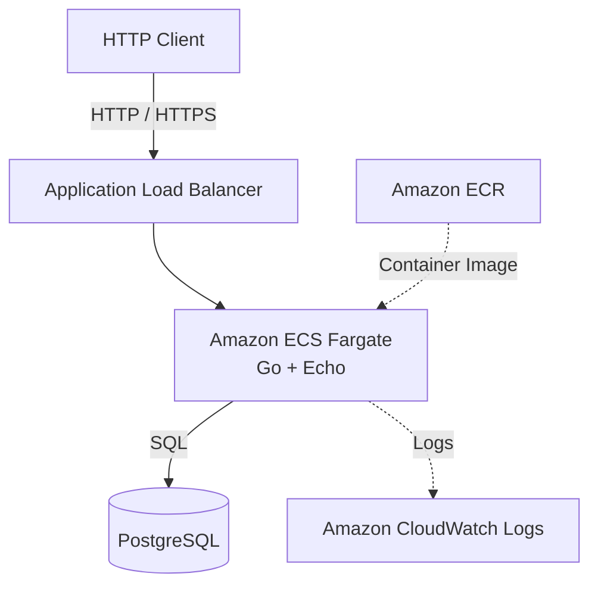

# Design Doc

## 1. 開発方針

本プロジェクトでは、CA Tech Lounge提出型選考の課題として、TODOリストを管理するREST APIを開発する。
まず必須要件の実装とローカル環境でのテストを完了させ、次にTerraformを利用してAWS環境へデプロイする。その後、認証・認可、gRPC、パフォーマンス改善などの追加機能を実装する。
開発工程はGitHub ProjectsのPhaseで管理し、個別の作業はGitHub Issuesで管理する。

選考課題の原文と提出条件はプロジェクト直下の`ASSIGNMENT.md`に記録する。`ASSIGNMENT.md`は外部から与えられた要件の記録、`DESIGN.md`はその要件に対する本プロジェクトの設計判断・開発方針・進捗の記録として扱う。課題文の必須要件と任意の追加要件を混同しない。

### 1.1 用語の定義

- バックエンド：GoとEchoで構成するサーバーアプリケーション全体
- API：バックエンドが提供するHTTPインターフェース
- APIコンテナ：バックエンドを実行するコンテナ
- PostgreSQL：バックエンドから接続するデータベースサービス

以降、アプリケーション全体を指す場合は「バックエンド」、HTTPインターフェースを指す場合は「API」と表記する。課題文の引用・要約では、原文に合わせて「API」と表記する。

### 1.2 PhaseとIssueの構成

#### Phase 1：Local Development

- Issue #1：開発方針の文書化とGo・Echo・PostgreSQLのローカル環境構築
- Issue #2：必須REST API 4本の実装
- Issue #3：OpenAPI仕様の定義
- Issue #4：Docker / Docker Composeによる起動環境構築
- Issue #5：必須機能のテストコード実装
- Issue #6：READMEと動作確認手順の整備

#### Phase 2：AWS Infrastructure

- Issue #7：TerraformによるAWSインフラ構築
- Issue #8：GitHub ActionsとOIDCによるCI/CD構築
- Issue #9：ECS Serviceの起動・停止運用
- Issue #10：AWS上での動作確認と証跡取得

#### Phase 3：Additional Features

- Issue #11：パスキー認証とユーザー別TODO管理
- Issue #12：TODOステータス管理
- Issue #13：TODO優先順位管理
- Issue #14：大量データを想定した負荷試験と性能改善
- Issue #15：追加機能に伴うOpenAPIとテストの更新
- Issue #16：gRPCエンドポイントの追加

### 1.3 ブランチ運用

GitHub ProjectsのPhaseは関連するIssueを開発段階ごとにまとめ、Issueは個別の作業単位として管理する。
開発には`main`、`develop`、Issueごとの作業ブランチを使用する。

1. 各Issueに着手する際、`develop`から作業ブランチ（`feature/issue-1`など）を作成する。
2. 実装・テスト完了後、`develop`に対するPull Requestを作成する。
3. コードレビューとCIの成功を確認したうえで`develop`にマージする。
4. Phase内のすべてのIssueが`develop`にマージされ、統合テストが成功した段階で、`develop`から`main`へのPull Requestを作成する。
5. Phase単位で`main`へマージし、その時点の成果物をリリースする。

`develop`を開発統合用ブランチ、`main`を各Phaseの完了時点における安定版として扱う。
Gitタグは使用せず、Pull Requestとコミット履歴で変更内容を追跡する。

### 1.4 モノレポ構成

バックエンド、将来追加するフロントエンド、IaCを同一リポジトリで管理するモノレポ構成を採用する。

```text
kyoya67-todo/
├── backend/
│   ├── cmd/
│   │   └── api/
│   ├── internal/
│   │   ├── config/
│   │   ├── auth/
│   │   ├── database/
│   │   │   └── sqlc/
│   │   ├── middleware/
│   │   ├── openapi/
│   │   ├── router/
│   │   └── todo/
│   └── db/
│       ├── migration/
│       └── query/
├── frontend/
├── api/
│   └── openapi/
├── infra/
│   └── modules/
│       ├── alb/
│       ├── amplify/
│       ├── ecr/
│       ├── ecs/
│       ├── elasticache/
│       ├── iam/
│       ├── internet_gateway/
│       ├── logs/
│       ├── rds/
│       ├── route53/
│       ├── route_table/
│       ├── secrets/
│       ├── security_groups/
│       ├── subnet/
│       └── vpc/
├── ASSIGNMENT.md
├── ai-usage/
├── compose.yaml
├── AGENTS.md
├── DESIGN.md
└── README.md
```

`backend/`ではGo、Echo、PostgreSQLアクセス、REST APIを管理する。`frontend/`は静的フロントエンドを管理し、AWS Amplify Hostingで配信する。バックエンドとは独立したアプリケーションとして扱う。`api/`ではバックエンドとフロントエンドで共有するAPI仕様を管理する。`infra/`ではAWS ECS Fargate、ECR、RDS、IAM、Route 53、Amplifyなどのインフラ構成をTerraformで管理する。`ai-usage/`ではPull RequestごとのAI利用記録を管理する。

既存ドメイン`kyo8.dev`のサブドメインとして、`ca-techlounge-todo.kyo8.dev`をフロントエンド、`api.ca-techlounge-todo.kyo8.dev`をバックエンドAPIに使用する。Route 53でDNSを管理し、ACMの証明書をAPI用ALBのHTTPSリスナーに関連付ける。

データベースマイグレーションは`golang-migrate`で管理する。`backend/db/migration/001_create_todos.up.sql`のようにup/downを同じバージョン番号で管理し、DB側に適用済みバージョンとdirty状態を記録する。ルートのMakefileから未適用分の適用、直前の1件のロールバック、dirty状態の手動修正を実行する。sqlcのスキーマ入力はup SQLだけに限定し、down SQLを生成コードのスキーマ解析へ混入させない。AWSではAPI用とは別のマイグレーション用コンテナイメージとECSワンショットタスクを使用し、RDSへ接続して完了後に停止する。

#### ローカル環境の環境変数

ローカルの共有設定はプロジェクト直下の`.env`で管理する。Composeは`compose.yaml`と同じディレクトリにある`.env`を、`${VARIABLE}`形式の値を置換するために自動で読み込む。

`.env`の値をすべてのサービスへ自動的に渡すのではなく、コンテナごとに必要な環境変数だけを明示する。バックエンドには`DB_HOST`、`DB_PORT`、`DB_USER`、`DB_PASSWORD`、`DB_NAME`を渡し、PostgreSQLには`POSTGRES_USER`、`POSTGRES_PASSWORD`、`POSTGRES_DB`として渡す。これにより、設定値は共通化しつつ、各コンテナが受け取る環境変数を制限する。

実際の`.env`はコミットせず、`.env.example`だけをリポジトリで管理する。クラウド環境の秘密情報は、Composeの`.env`ではなくSecrets ManagerやParameter Storeなどのサービスで管理する。

#### Docker Composeによるローカル起動

`backend/Dockerfile`はGoのバックエンドコンテナイメージを作成するマルチステージDockerfileとし、ローカル環境とAWS ECS Fargateで共通利用する。実行環境固有の設定はDockerfileに埋め込まず、ローカルでは`compose.yaml`、AWSではECSタスク定義から環境変数・シークレットを注入する。

`compose.yaml`では、バックエンド、PostgreSQL、Redis、Swagger UIを別々のコンテナとして起動する。バックエンドはComposeネットワーク上のサービス名`db`をDBホスト、`redis`を一時認証データの保存先として利用し、双方のhealthcheckが成功してから起動する。Redisのホスト側公開は`127.0.0.1`に限定する。バックエンドのコンテナ内部ポートは`BACKEND_CONTAINER_PORT`で管理し、Goアプリの待受ポート、Dockerfileの`EXPOSE`、Composeのコンテナ側ポートへ同じ値を渡す。ホスト側の公開ポートはルート`.env`の`BACKEND_PORT`、`DB_PORT`、`REDIS_PORT`、`SWAGGER_UI_PORT`で変更できる。

#### CORS

バックエンドにはCORSミドルウェアを設定する。許可するOriginは`CORS_ALLOWED_ORIGINS`環境変数でカンマ区切りに指定し、ローカル開発ではSwagger UIと将来のフロントエンド開発サーバーのOriginを許可する。すべてのOriginを無条件に許可せず、クラウド環境では環境ごとのOriginを明示する。

---

## 2. AIの活用方針

本プロジェクトでは、ChatGPTとOpenAI Codexを開発プロセスに取り入れる。
ChatGPTを技術選定・設計相談・タスク管理に利用し、Codexを実装支援に利用する。

### 2.1 使用するツール

- ChatGPT：技術調査、設計相談、タスク分解、GitHub Issuesの作成
- OpenAI Codex：コード実装、テスト作成、エラー原因の調査、コード修正
- GitHub Projects：開発工程とIssueの進捗管理
- GitHub Pull Requests：変更差分の確認とレビュー

### 2.2 ChatGPTを利用した技術選定

開発開始前にChatGPTとの対話を通じて、バックエンドの技術選定とAWSへのデプロイ方式を検討した。

主な検討内容は以下のとおり。

- Go標準ライブラリとGin・Echoの比較
- EchoとGinのルーティング・エラーハンドリングの違い
- HTTP QUERYメソッドとGET・POSTの使い分け
- AWS LambdaとECS Fargateの比較
- ローカルとAWS環境におけるDockerイメージの再利用
- ECS Serviceを必要時のみ起動するコスト管理方式
- Terraformによるインフラ構築
- GitHub ActionsとOIDCによるAWSへのデプロイ

技術選定では、特定のフレームワークの性能だけでなく、実装の複雑さ、テストの負担、保守性、学習目的などを比較した。
ChatGPTの提案をそのまま採用するのではなく、課題の要件に適しているかを判断基準とした。

### 2.3 ChatGPTによるタスク管理

技術選定後、ChatGPTとGitHubリポジトリを連携し、開発計画をGitHub Issuesに落とし込んだ。

実施した作業は以下のとおり。

1. 課題の必須要件と追加要件を整理する。
2. 開発工程を3つのPhaseに分割する。
3. 各Phaseに必要な作業をIssue単位に分解する。
4. ChatGPTのGitHub連携を利用して16件のIssueを作成する。
5. GitHub ProjectsでPhaseごとにタスクを管理する方針を定める。

### 2.4 Codexによる実装支援

実装工程では、CodexにGitHub Issueを参照させ、Issueに記載した要件と完了条件に従って作業を進めてもらう方針とする。

想定する開発フローは以下のとおり。

1. GitHub Issueで実装範囲と完了条件を定義する。
2. `develop`からIssue用の作業ブランチを作成する。
3. Codexに対象Issueの実装を依頼する。
4. Codexがコードとテストを作成する。
5. 開発者が変更差分と生成コードをレビューする。
6. テスト・動作確認を実施し、必要に応じて修正する。
7. Pull Requestを`develop`へマージする。
8. 対象Issueを完了として更新する。

### 2.5 開発者自身が判断・検証すること

以下の項目については開発者自身が最終的な責任を持つ。

- 課題の要件解釈
- 技術選定とアーキテクチャの決定
- APIとデータモデルの設計
- AI生成コードの理解とレビュー
- テストの妥当性の確認
- 実際の動作確認
- セキュリティ・保守性・パフォーマンスの検証
- AIの提案を採用・修正・却下する判断
- Design Docの内容

AIが生成したコードや文章については、使用箇所、採用理由、検証方法を記録する。また、選考課題の注意事項に従い、AIの利用目的や主なプロンプトも記録する。実施済みの作業と今後の予定は明確に区別し、実際に行っていない検証を実施済みとして記載しない。

AIの具体的な利用履歴、代表的なプロンプト、採用・修正・不採用の判断、検証結果は、プロジェクト直下の`ai-usage/`でPRごとにファイルを分けて管理する。どのPRの変更にAIを利用したか追跡できる状態にし、代表的なプロンプトは対応する利用履歴の中に記載する。

---

## 3. 要件の整理

### 3.1 必須機能要件

本課題では、TODOリストを管理する4つのREST APIを実装する。

#### TODO作成

タイトルを指定してTODOを新規作成する。

データベースに最低限保存する項目は以下のとおり。

- TODOを一意に識別するID
- タイトル
- 登録日時
- 更新日時

正常に作成された場合はHTTP 204を返す。

#### TODO一覧取得

データベースに保存されたTODOの一覧を取得する。
特定のクエリパラメータが指定された場合、タイトルが指定された文字列に部分一致するTODOのみ取得する。
正常に取得できた場合はHTTP 200を返し、TODOの配列をJSON形式で返す。

#### TODO更新

指定されたTODOのタイトルと更新日時を変更する。

- 正常時：204
- 指定したTODOが存在しない場合：404

TODO APIでは入力不正を400、対象なしを404、依存先の失敗を503へ変換する。503の場合はバックエンドログに操作名と失敗段階だけを記録し、タイトル・DBエラーの生文字列などを出さない。クライアントへは詳細を公開しない。

#### TODO削除

指定されたTODOをデータベースから削除する。

- 正常時：204
- 指定したTODOが存在しない場合：404

### 3.2 追加機能要件

- パスキー認証によるログイン
- ユーザーごとのTODO管理
- 未着手・進行中・完了のステータス管理
- TODOの優先順位設定
- 大量データ登録時の負荷対策
- gRPCによるAPIの提供

Issue #11ではCognitoを使わず、既存のGoバックエンドでWebAuthnによるパスキー認証を実装する。暗号処理は実績あるライブラリへ委ねる。メール、パスワード、OTPを要求せず、パスキーだけで新規登録とログインを行う。ローカルとAWSでは同じコード・マイグレーションを使用するが、ユーザー・公開鍵・TODOは各環境のPostgreSQLに別々に保存する。RP IDと許可Originを環境ごとに設定し、全パスキーを失った場合のアカウント復旧は提供しない。CognitoによるDev/Prod User Pool共有案は、開発者ごとに独立したローカル認証環境を再現できないため取り下げた。

認証コードは`internal/auth/`へまとめ、WebAuthn初期化、登録・ログイン、セッション処理を小さな単位で追加する。TODOコードも`internal/todo/`へ集約し、各機能ディレクトリ内でHandler・Service・Repositoryの責務をファイル単位で分ける。TODOの層別パッケージを移動した理由は、認証とTODOの機能境界を揃え、機能の変更時に関連コードを追いやすくするため。`todo`パッケージ内の型とコンストラクタは`Handler`・`Service`・`Repository`と命名し、機能名の重複を避ける。OpenAPIが規定する`CreateTodo`などのHandlerメソッド名と、sqlc生成メソッド名は変更しない。`cmd/api/main.go`で両機能のRepository・Service・Handlerを組み立て、`internal/router/`は完成済みHandlerをOpenAPI生成ルートへ登録する。認証のHandler→Service、Service→検証器・アカウント保存先・チャレンジ保存先はinterfaceで接続する。一方、HandlerとServiceは`go-webauthn`の型を共有しているため、WebAuthnライブラリから完全に独立した設計ではない。Go 1.25と互換性のある`go-webauthn/webauthn` v0.17.4を使用し、登録開始・登録完了のHandlerとServiceをOpenAPI生成ルーティングへ接続した。

登録フローの保存先として、`users`と`passkey_credentials`を使用する。ユーザーIDはServiceがランダムなUUIDとして生成し、Credential IDはバイナリの主キーとして一意に保持する。ライブラリが返す公開鍵や署名カウンターを含むCredential情報はJSONBで保存し、ユーザーIDへの外部キーを持たせる。Repositoryではユーザー作成とCredential保存を同一トランザクションで行い、一方が失敗した場合は両方を確定しない。

登録とログインのHandlerは`internal/auth/handler.go`の単一の`Handler`、Serviceは`internal/auth/service.go`の単一の`Service`にまとめる。ログイン固有の検証器・チャレンジ・セッションは`WithLogin`でServiceへ渡し、PostgreSQLのRepositoryを共有する。Redis保存処理は`store.go`に置く。テストも各実装ファイルに対応する`handler_test.go`、`service_test.go`、`store_test.go`にまとめる。

ログイン完了のHTTP 400は入力の不正とWebAuthn検証失敗の両方で返る。原因を切り分けられるよう、バックエンドログには処理段階と固定の拒否理由だけを記録し、署名・チャレンジ・ユーザーハンド・セッショントークンやライブラリの生エラーは記録しない。クライアントへのエラー応答も詳細を公開しない。

#### パスキー登録の責務分担

| 対象 | 責務 |
|---|---|
| Handler | HTTPのOrigin・Content-Type・本文サイズ・JSON形式を確認し、ライブラリで応答をパースする。Serviceの結果をHTTPステータスへ変換し、内部エラーを外へ返さない |
| Service | ユーザーID発行、登録期限・チャレンジの使い捨て、WebAuthn検証、検証済みCredentialの必須項目確認、保存依頼を行う。Echoには依存しない |
| WebAuthn初期化 | RP ID・許可Origin、discoverable credential必須、ユーザー検証必須、登録タイムアウトを設定する。暗号処理はライブラリに委ねる |
| Repository | ユーザーとCredentialを同一トランザクションで保存する。Credentialは値で受け取り、nilの扱いを不要にする |
| ChallengeStore | Redisに登録中のデータをTTL付きで保存し、`GETDEL`で一度だけ取り出す。Serviceが利用するinterfaceの実装として扱う |

`POST /auth/registration/begin`は5分間有効な登録IDとWebAuthn作成オプションを返す。ブラウザの応答を`POST /auth/registration/finish`へ送り、検証成功時のみユーザーとCredentialを保存して204を返す。登録だけではログインCookieを発行しない。HandlerとService、Serviceと保存先はinterfaceで接続する。

チャレンジを含むライブラリのSessionDataは、RedisへTTL付きで保存する。これはログイン後のセッションとは別の、登録中だけのデータである。登録IDは暗号学的乱数32バイトで生成し、RedisのキーにはSHA-256ハッシュだけを含める。`SET NX`で衝突を拒否し、登録完了時に`GETDEL`で原子的に消費する。検証失敗やDB保存失敗の場合も同じ登録IDは再利用できず、ユーザーは登録開始からやり直す。期限切れキーはRedisが自動削除する。

初期案のPostgreSQL専用テーブルは、Issue #11の設計相談で、ログイン時のチャレンジとCookieセッションもRedisへ保存する方針に変更したため、未適用のマイグレーション003ごと取り下げた。永続データ（ユーザー・Credential・TODO）はPostgreSQL、一時的な認証データはRedisと分ける。ローカルはCompose、AWSはプライベートサブネットのElastiCache for Redis OSSを使用する。ECSからRedisへの6379番ポートのみ許可し、AWS側の接続はTLS必須、ローカルはループバックへのポート公開とCompose内通信を使用する。Redisへのアクセス制御はVPCとSecurity Groupで行い、現時点ではRedis AUTHトークンを設定しない。1ノード構成はコストを抑えるが、ノード障害や再作成時には登録中のデータが失われ、登録をやり直す必要がある。ElastiCacheはECS Serviceを停止しても費用が継続するため、AWSへの適用は別途確認する。

`WEBAUTHN_RP_ID`と`WEBAUTHN_ORIGIN`を環境変数で指定する。Composeの既定値は`localhost`と`http://localhost:3000`で、Redis接続先はコンテナ内の`redis:6379`。ホスト上でGoを直接実行する場合はRP ID・Originと`REDIS_ADDR=localhost:6379`を指定する。認証設定を省略したままバックエンドを起動させないため、RP ID・Origin・Redis接続先のいずれかが未設定なら設定読み込み時にエラーとする。Redisへの接続も起動時のPingで確認し、失敗時は起動を停止する。AWSではElastiCacheのエンドポイントを`REDIS_ADDR`、TLS接続を`REDIS_TLS=true`としてECSに渡す。登録APIではフロントエンドのOriginとの完全一致を要求するため、通常のSwagger UIのOrigin（8081）からの登録は403になる。WebAuthn自体のOriginもライブラリで検証する。

ログインは`POST /auth/login/begin`でdiscoverable credential用のWebAuthnオプションと5分間有効なログインIDを発行し、Redisへチャレンジを保存する。`POST /auth/login/finish`ではログインIDを`GETDEL`で一度だけ消費し、Credential IDとユーザーハンドに一致する公開鍵をPostgreSQLから読み込む。実WebAuthnライブラリで署名・チャレンジ・Origin・ユーザー検証を確認した後に、署名カウンター等をCredentialのJSONBへ書き戻し、Redisへ24時間のセッションを保存する。ブラウザにはランダムなセッショントークンをHttpOnly・SameSite=StrictのCookieで返し、HTTPS環境ではSecureも付ける。RedisにはトークンのSHA-256ハッシュをキーとして保存する。Originは明示許可し、Cookie付きのCORSリクエストを許可する。ログイン失敗時はCookieを発行しない。

静的フロントエンドではbase64urlとWebAuthn用バイト列を相互変換し、登録は`navigator.credentials.create`、ログインは`navigator.credentials.get`を使用する。登録とログインは開発者がローカルブラウザで確認済み。登録側は実DB・Redis統合テストがある。ログイン実装では、実WebAuthnライブラリを使った合成署名の検証、Fake保存先を用いたServiceテスト、実RedisでのログインID・セッション保存テストを実施した。ログイン全体を通す実DB統合テストは未実施。

TODOの全操作には認証ミドルウェアを適用する。`todo_session` Cookieのトークンをハッシュ化してRedisのセッションを読み取り、存在しない・期限切れの場合はHTTP 401、Redis障害の場合はHTTP 503を返す。`/health`と`/auth/`は公開したままとし、CORSのOPTIONSリクエストは認証対象外にする。認証済みユーザーIDはリクエストコンテキストに保存し、HandlerからService、Repositoryへ渡す。TODOは共通テーブルの`user_id`で所有者を表し、作成時は認証済みIDを保存する。一覧・更新・削除のSQLには必ず所有者条件を含める。他人のTODOの更新・削除は存在しないIDと同じHTTP 404で返す。クライアントが指定したユーザーIDは使用しない。

既存TODOには所有者を特定する情報がないため、マイグレーション003では`user_id`をnullableで追加し、既存行を所有者未設定のまま保存する。これらはユーザー別APIから見えず、削除も自動割当ても行わない。所有者付きTODOがある場合のdownマイグレーションは、所有者情報の消失を防ぐため拒否する。後日、既存行を移行・整理する際は明示的に方針を決める。CSRF対策、レート制限、ログアウト、AWS上の接続確認は後続実装であり、現段階で本番運用可能な認証機能とは扱わない。

今回の実装にはOpenAI Codexを利用した。開発者の「それぞれの責務を考えた上でhandlerとserviceも作っちゃって」という依頼と、Repositoryに置いた入力確認の責務への指摘を受け、上記の分離とテストを追加した。その後の「ログイン時のチャレンジやセッションもredis使う予定だからやはりチャレンジはredisにしよう」という判断に合わせて保存先を変更した。対応PRは未作成のため、PR番号確定時に`ai-usage/PR-<番号>.md`へ利用内容と検証結果を記録する。

### 3.3 非機能要件・開発上の方針

- Dockerでアプリケーションを起動できる
- PostgreSQLにTODOを永続化する
- 必須機能を検査するテストを用意する
- AWS上にアプリケーションをデプロイできる
- Terraformでインフラ構成を再現できる
- GitHub ActionsでCI/CDを実行する
- AWSへの認証にはOIDCを使用する
- アプリケーションログを記録する
- 必要な時間のみECSタスクを起動してコストを抑える

---

## 4. 技術選定とトレードオフ

### 4.1 バックエンド言語

| 採用 | 技術 | 判断理由 |
|---|---|---|
| ○ | Go | HTTPサーバーやDBアクセスを実装しやすく、既存の学習経験を活用できる |
| — | TypeScript / Node.js | 実装経験はあるが、今回はGoでのバックエンド実装を重視する |

### 4.2 Webフレームワーク

| 採用 | 技術 | メリット・判断理由 |
|---|---|---|
| ○ | Echo | バインド、エラーハンドリング、ロギングなどの共通処理を利用できる |
| — | Gin | バリデーションとの連携やエコシステムが充実しているが、今回はEchoのエラー処理設計を優先する |
| — | net/http | 外部依存を減らせるが、共通処理の設計・実装が必要になる |

Go標準ライブラリでもREST APIは実装可能である。
しかし、共通エラーハンドリング、リクエストのバインド、ロギング、ミドルウェアなどを自作すると、実装とテストの対象が増加する。
Echoを利用することで独自実装を減らし、業務ロジックとDBアクセスに注力する。
また、Echoのハンドラは`error`を返す構造になっており、エラー処理を共通のハンドラへ委譲できる。
ただし、Echoを採用することでフレームワーク固有の依存が生じる点はトレードオフとなる。

### 4.3 データベース

| 採用 | 技術 | 判断理由 |
|---|---|---|
| ○ | PostgreSQL | 制約、トランザクション、インデックスなどを利用でき、追加機能にも対応しやすい |
| — | MySQL | CRUDには十分だが、今回はPostgreSQLの利用経験と拡張性を優先する |

### 4.4 データアクセス方式

| 評価項目 | sqlc + pgx/v5 | sqlc + database/sql | GORM | 生SQL + database/sql | 生SQL + pgx |
|---|---|---|---|---|---|
| SQLの自由度 | ◎ | ◎ | ○ | ◎ | ◎ |
| 静的検証 | ◎ | ◎ | △ | × | × |
| 型安全性 | ◎ | ◎ | △ | × | × |
| ORMのオーバーヘッド | なし | なし | あり | なし | なし |
| 動的クエリ | △ | △ | ◎ | ◎ | ◎ |
| CRUD実装の手軽さ | ○ | ○ | ◎ | △ | △ |
| 接続プール | ◎ | ○ | ○ | ○ | ◎ |

| **採用** | **技術** | **判断理由** |
|---|---|---|
| ○ | sqlc + pgx/v5 | CRUD中心で複雑な動的クエリが少なく、SQLの明示性、生成コードによる型安全性、PostgreSQL向け接続プールを利用できる |
| — | sqlc + database/sql | 型安全なコード生成は利用できるが、今回はPostgreSQL専用の機能とpgxの接続プールを優先する |
| — | GORM | CRUD実装は容易だが、SQLと生成される処理の対応を明示的に管理しにくいため、今回は採用しない |
| — | 生SQL + database/sql | SQLの自由度は高いが、型安全なコード生成や結果のマッピングを個別に実装する必要がある |
| — | 生SQL + pgx | PostgreSQLの機能と接続プールを利用できるが、型安全なコード生成や結果のマッピングを個別に実装する必要がある |

SQLまたはデータベーススキーマを変更した場合は、開発時とCIで`sqlc vet`を実行してSQL・スキーマの整合性を確認し、`sqlc generate`で生成コードを更新する。生成コードは直接編集せず、生成コード自体の単体テストは原則として作成しない。Repositoryについては、sqlc生成コードを介したSQL実行結果、引数、エラー処理をテスト用データベースまたはモックで検証する。

### 4.5 API仕様

| **採用** | **技術** | **判断理由** |
|---|---|---|
| ○ | OpenAPI | 必須要件であるREST APIのエンドポイント、パラメータ、リクエスト・レスポンス、HTTPステータスを管理する。課題文で明示された必須要件ではないが、仕様と実装の対応を確認しやすくするため採用する |
| ○ | oapi-codegen（Echo server） | OpenAPIを正としてGoの型、Echo用Server Interface、ルーティング登録コードを生成し、仕様と実装の不整合をコンパイル時に検出しやすくする |
| △ | Protocol Buffers（`.proto`） | 課題文の追加要件であるgRPCを実装する場合に、サービス、RPCメソッド、メッセージ型を定義する。gRPCを実装する余裕がある場合に採用する |
| △ | GraphQL Schema | 課題文の追加要件であるGraphQLを実装する場合に、Query、Mutation、型、入力値を定義する。GraphQLを実装する余裕がある場合に採用する |
| △ | Protocol Buffers（`.proto`） + Connect | Connectを追加で採用する場合に、RPCメソッドとメッセージ型を定義する。課題文にConnectの指定はないため、gRPCやGraphQLより優先しない |
| — | AsyncAPI | 現時点ではイベント駆動のメッセージングを実装しないため採用しない |

#### OpenAPI・oapi-codegenの採用経緯

APIの具体的なURL、リクエスト・レスポンス形式、入力検証、エラー仕様を仕様書として共有するため、OpenAPIを採用する。OpenAPI定義をAPI仕様の正とするSpec-first方針により、フロントエンド、Swagger UI、バックエンド実装の認識を揃え、実装と仕様のずれを減らす。

さらに、OpenAPIの定義とGo/Echoの実装を手動で別々に管理すると、パス、パラメータ、リクエスト・レスポンス型の不整合が発生しやすい。そのため、`oapi-codegen`を利用して、`api/openapi/openapi.yaml`からGoのリクエスト・レスポンスモデル、Echo用のServer Interface、ルーティング登録コード、埋め込み仕様を生成する。

生成コードは`backend/internal/openapi/`で管理し、直接編集せず、OpenAPI定義を修正して再生成する。Handlerは生成されたServer Interfaceを実装し、ServiceとRepositoryの業務処理・DBアクセスは手動で実装する。これにより、API契約とHandlerの不整合をコンパイル時に検出しやすくする。

### 4.6 コンテナ実行環境

| 採用 | 技術 | 判断理由 |
|---|---|---|
| ○ | ECS Fargate | EchoのHTTPサーバーをコンテナとして起動でき、ローカルとAWSで同じイメージを利用できる |
| — | AWS Lambda | 低トラフィック時のコスト面では有利だが、Echoを動かすにはLambda向けの実行方式への対応が必要になる |

ローカルで利用したDockerイメージをECRにプッシュし、ECS Fargateで実行する。
AWS環境は1つのみ構築し、`main`へのマージをデプロイの基準とする。
ECS Serviceは必要時のみタスク数を1に増やし、利用しない場合は0へ減らす。
停止中はAPIへアクセスできないため、READMEに起動・停止手順を記載する。

### 4.7 IaC

| 採用 | 技術 | 判断理由 |
|---|---|---|
| ○ | Terraform | リソースを宣言的に管理し、変更履歴と再現性を確保できる |
| — | CloudFormation | AWSとの統合度は高いが、今回はTerraformの利用を優先する |
| — | 手動構築 | 初期検証は容易だが、構成の再現性や変更管理の面で不利 |

### 4.8 CI/CD

**採用：GitHub Actions + AWS OIDC**

GitHub ActionsからAWSへアクセスする際はOIDCを利用する。
長期アクセスキーをGitHub Secretsに保存せず、一時的な認証情報を利用してECR・ECSへのデプロイを行う。

GitHub Actions用のOIDCプロバイダー、IAMロール、信頼ポリシー、ECR・ECS操作権限はTerraformの`infra/modules/iam/`で管理する。OIDCプロバイダーのAudienceは`sts.amazonaws.com`とし、信頼対象は対象リポジトリの`main`ブランチに限定する。GitHub ActionsのworkflowやGitHub側のVariables・Secretsはリポジトリ側で管理し、AWS側の長期アクセスキーは使用しない。

### 4.9 Go外部パッケージ

| **分類** | **importするパッケージ** | **用途** |
|---|---|---|
| Webフレームワーク | Echo (`github.com/labstack/echo/v4`) | HTTPサーバー、ルーティング、JSONレスポンス、ミドルウェアを提供する |
| PostgreSQLドライバ・接続プール | pgx/v5 (`github.com/jackc/pgx/v5`) | PostgreSQLとの通信、`pgxpool`による接続プール、PostgreSQL固有型を扱う |
| 環境変数ファイル読み込み | godotenv (`github.com/joho/godotenv`) | ローカル開発時にプロジェクトルートの`.env`を読み込む |

---

## 5. システム構成とデータモデル

### 5.1 バックエンドの構成

### 5.2 データベース設計

### 5.3 AWS構成

AWS環境は1つのみ構築する。



Terraformのルート設定からAWSサービス単位のモジュールを呼び出す。VPC、ネットワーク、セキュリティグループ、ALB、ECS、ECR、RDS、ElastiCache、Secrets Manager、CloudWatch Logs、IAMを分離して管理し、ルートの`aws.tf`ではモジュール間の依存関係を接続する。

RDSはプライベートサブネットに配置し、ALBはパブリックサブネットに配置する。ECSタスクはコストを抑えるため初期のdesired countを0とし、必要時だけ起動する。RDSの`rds.force_ssl`を有効化し、ECSでは`sslmode=verify-full`とAWS RDS CAバンドルを指定する。ローカルComposeではPostgreSQLがTLS未設定のため、`DB_SSLMODE=disable`を既定値とし、環境変数で接続設定を切り替える。

### 5.4 DBパスワード管理

RDSの管理ユーザーパスワードは、Terraformの`ephemeral`変数として実行時に受け取る。`ephemeral`により、パスワードをTerraform stateへ保存しない。RDSの`password_wo`とSecrets Managerの`secret_string_wo`を使用し、TerraformからAWSへパスワードを書き込むが、AWSからTerraformへパスワードを読み戻さないwrite-only方式を採用する。

RDSとSecrets Managerへ同じパスワードを渡す必要があるため、パスワード変更時は`db_password_version`を増やす。このバージョン番号を`password_wo_version`と`secret_string_wo_version`へ渡し、write-only値の更新をTerraformへ明示する。バージョン番号は自動ローテーション機能ではなく、手動更新の世代管理に使用する。

実際のパスワードはリポジトリへ保存せず、ローカルでは`infra/.env`、AWS環境では実行環境のSecretへ注入する。write-onlyや`ephemeral`を使用しても、シェル履歴、ログ、CI/CDの設定などに値が残る可能性はあるため、これらも秘密情報として管理する。

---

## 6. CI/CD

### 6.1 全体方針

CIはPull Requestの作成・更新時に実行し、Goのテスト・静的解析、sqlcのSQL検証と生成コードの差分確認、Terraformのフォーマット・検証、バックエンドコンテナイメージのビルドを行う。CIではAWSへの認証やデプロイを行わず、CDと責務を分離する。
各Issueの作業が完了したら`develop`へPull Requestを作成する。
Phaseに属するすべてのIssueが`develop`へマージされ、統合テストが成功した段階で、`main`へのPull Requestを作成する。
AWS環境は1つのみとし、`main`へのマージをAWSデプロイの基準とする。

### 6.2 CI

CIはPull Requestで実行する。最初に変更パスを判定し、関係する検証ジョブだけを実行する。ワークフロー設定自体を変更した場合は、各検証ジョブを実行する。

- バックエンド：`go test ./...`、`go vet ./...`
- sqlc：`sqlc vet`、`sqlc generate`を実行し、生成コードに未コミットの差分がないことを確認
- Terraform：`terraform fmt -check -recursive`、`terraform init -backend=false`、`terraform validate`
- コンテナ：バックエンドのDockerイメージをビルド
- フロントエンド：Node.jsの依存関係をインストールし、Prettierのフォーマットチェック

CIではAWSへのデプロイは行わず、コードとTerraform構成の静的・ビルド検証に限定する。

### 6.3 CD

CDは`main`へのpushを起点に実行する。変更されたパスを判定し、`backend/`、`api/`、`infra/`またはCD設定に変更がある場合だけバックエンドをECR・ECSへデプロイする。`backend/db/migration/`に変更がある場合は、マイグレーション用イメージをコミットハッシュでECRへ登録し、そのタグを指定したECSワンショットタスクを実行してからバックエンドをデプロイする。初回のイメージ登録や手動確認では、Terraformで作成したタスクを`make db-migrate-ecs`から実行できる。`frontend/`またはCD設定に変更がある場合は、GitHub ActionsのCDでフロントエンドをZIP化してAmplifyへデプロイする。バックエンドとフロントエンドは独立したジョブとして実行する。

Amplifyへのデプロイでは、GitHub ActionsのCDがフロントエンドをZIP化し、Amplifyのデプロイ用アップロードURLへ転送した後、デプロイを開始して完了状態を確認する。AmplifyアプリIDはGitHubリポジトリ変数で管理し、AWS認証はOIDCを使用する。
