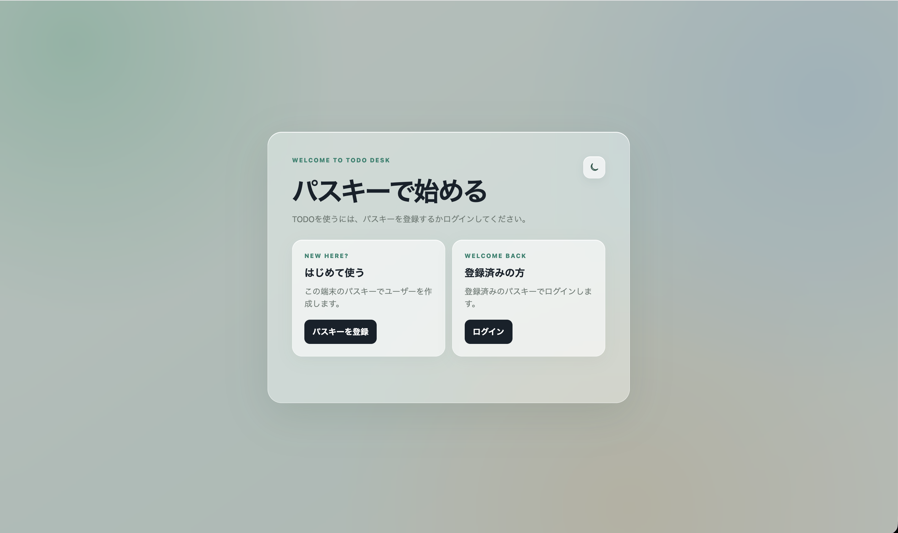
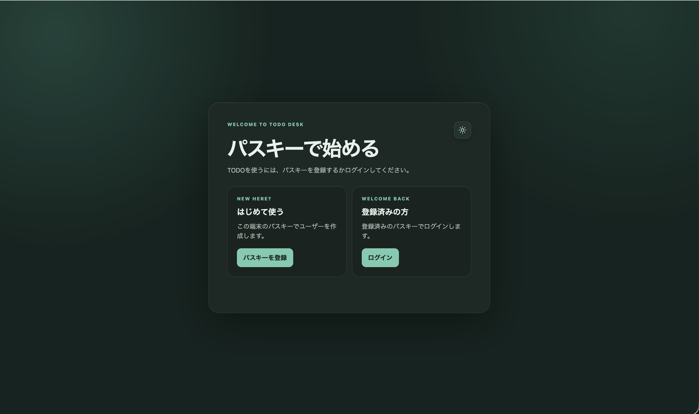
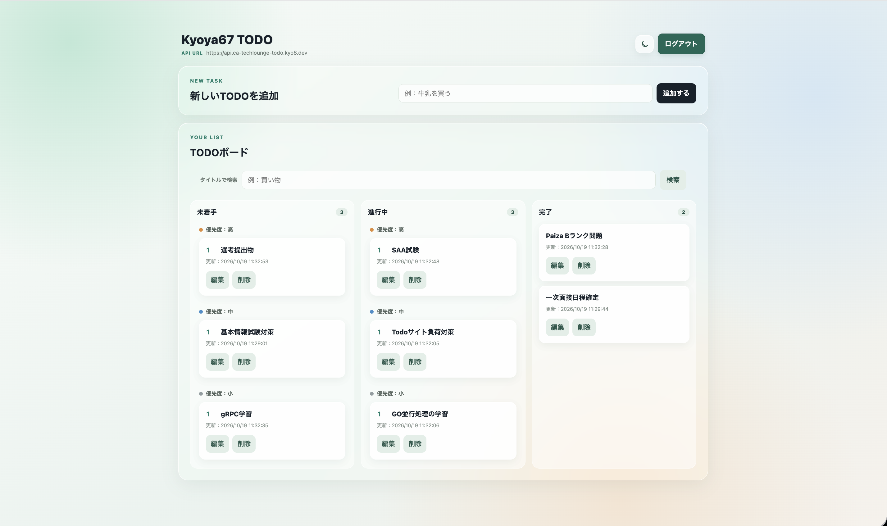
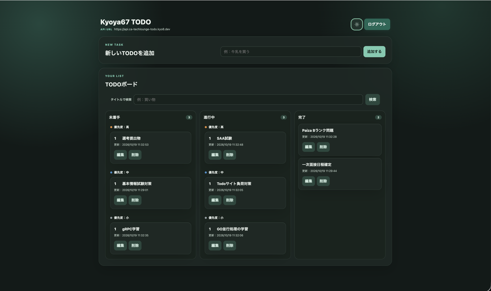

# Kyoya67 TODO

パスキーで登録・ログインし、TODOをユーザーごとに管理できるWebアプリケーション。

## 公開中のアプリ
[https://ca-techlounge-todo.kyo8.dev/](https://ca-techlounge-todo.kyo8.dev/)

ブラウザでパスキーを使って登録・ログインし、TODOを管理できます。TODOの作成、検索、編集、削除に加え、ドラッグ操作で状態や優先順位を変更できます。
APIは運用コストを抑えるため停止している場合があります。その間はログインやTODO操作を利用できません。

## 画面の見た目

ライトモードは淡いグリーンとブルーの背景に白いカードを重ねた、明るいデザインです。ダークモードは深緑の背景と落ち着いた色のカードで、同じ操作を利用できます。ログイン画面とTODOボードのどちらでも、画面右上のアイコンから切り替えられます。

ログイン画面ではパスキーの登録・ログインを選択できます。ログイン後のTODOボードは「未着手」「進行中」「完了」の3列に分かれ、優先度ごとにタスクを表示します。

### パスキー登録・ログイン画面

| ライトモード | ダークモード |
|---|---|
|  |  |

### TODOボード

| ライトモード | ダークモード |
|---|---|
|  |  |

## ドキュメント全体像

| ドキュメント | 内容 |
|---|---|
| [DESIGN.md](DESIGN.md) | 開発方針、構成、技術選定、設計判断 |
| [AGENTS.md](AGENTS.md) | 開発時の実装・ドキュメントのルール |
| [backend/TESTING.md](backend/TESTING.md) | 単体テスト、統合テスト、カバレッジ、検証方法 |
| [api/openapi/openapi.yaml](api/openapi/openapi.yaml) | REST API仕様の正となるOpenAPI定義、コード生成元 |

# 考察

Go/Echo、PostgreSQL、sqlc、OpenAPI、AWS ECS Fargateを採用し、API仕様と実装のずれを減らしながら、ローカルとクラウドで同じAPIを確認できる構成にした。レイヤー分離、SQLの型安全なコード生成、TerraformによるAWS管理、GitHub Actionsによるデプロイを選んだ理由や設計上の判断は、[DESIGN.md](DESIGN.md)にまとめている。

# 作成したアプリケーションの起動・動作確認手順

## 前提

- Go
- Docker Desktop
- Docker Compose
- Node.js（`npx`を含む）
- sqlc

## 環境変数

プロジェクト直下の`.env.example`をコピーして`.env`を作成する。

## ローカル環境の起動

バックエンド、PostgreSQL、Swagger UIをDocker Composeで起動する。フロントエンドはNode.jsの静的HTTPサーバーで配信する。

`````sh
cp .env.example .env
`````

### バックエンド・DB・Swagger UIの起動

プロジェクトルートで実行する。

`````sh
docker compose config
docker compose up -d --build
docker compose ps
`````

`backend`、`db`、`swagger-ui`が起動し、`db`サービスが`healthy`になっていることを確認する。Swagger UIは[http://localhost:8081](http://localhost:8081)で利用できる。

### フロントエンドの起動

別のターミナルでプロジェクトルートから実行する。

`````sh
cd frontend
npm ci
cd ..
npx serve frontend -l 3000
`````

ブラウザで[http://localhost:3000](http://localhost:3000)を開く。ローカルで立ち上げたフロントエンドでは`http://localhost:8080`をAPI URLとして自動設定する。

### マイグレーション

PostgreSQLコンテナが起動している状態で、プロジェクトルートから実行する。`golang-migrate`が適用済みバージョンを管理し、未適用のSQLだけを実行する。

`````sh
make db-migrate-up
`````

開発環境で直前のマイグレーションを一つ取り消す場合は、次を実行する。

`````sh
make db-migrate-down
`````

適用途中で失敗してdirty状態になった場合は、原因を修正した上で、対象バージョンを指定して状態を修正する。

`````sh
make db-migrate-force VERSION=1
`````

マイグレーションファイルは`backend/db/migration/001_create_todos.up.sql`と`001_create_todos.down.sql`のように、同じバージョン番号のup/downを追加する。

### Swagger UIから確認する

ブラウザで[http://localhost:8081](http://localhost:8081)を開く。各エンドポイントを選択して「Try it out」を押し、必要なパラメータやリクエストボディを入力して「Execute」を押す。レスポンスのステータスコードとJSONを確認する。

Swagger UIでは、次の4つのTODO APIを順番に確認できる。

1. `POST /todos`でTODOを作成する
2. `GET /todos`で一覧を取得する
3. `PUT /todos/{id}`で作成したTODOを更新する
4. `DELETE /todos/{id}`で作成したTODOを削除する

最初に`GET /health`を実行し、HTTP 200と`{"status":"ok"}`が返ることを確認する。

### ローカル環境の停止

プロジェクトルートでComposeのサービスを停止する。

`````sh
docker compose down
`````

`docker compose down -v`を実行するとPostgreSQLのボリュームも削除されるため、保存データを削除する場合以外は使用しない。

## クラウドAPIをSwagger UIで確認する

クラウド上のAPIをSwagger UIから確認する場合は、ローカル環境を起動して[http://localhost:8081](http://localhost:8081)を開く。画面上部のサーバー選択欄で`AWS上のAPI`を選択すると、ローカルSwagger UIからクラウドAPIを実行できる。

TODO APIは次の順番で確認する。

1. `GET /health`でHTTP 200とヘルスチェック結果を確認する
2. `POST /todos`でTODOを作成する
3. `GET /todos`で一覧を取得する
4. `GET /todos?title=...`でタイトルの部分一致検索を確認する
5. `PUT /todos/{id}`で作成したTODOを更新する
6. `DELETE /todos/{id}`で作成したTODOを削除する
